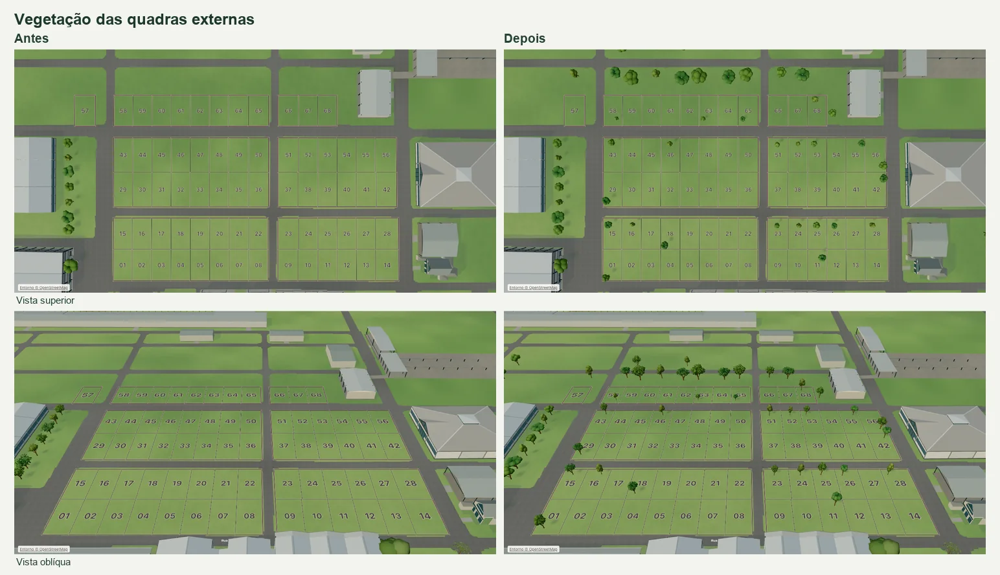

# Vegetação nas quadras externas do Parque de Exposições

A vista aérea do Parque Alfredo Leandro Carlson mostra uma faixa densa de copas ao sul da Rua Chile, em L/F, e árvores mais espaçadas junto à Rua Brasil e nas laterais de J/E. Em I/D predominam as clareiras, com árvores isoladas e um agrupamento ao longo da Rua Uruguai em D. As capturas da Indumóveis e a vista Superior do mapa publicado mostram o bosque da Árvore Lunar já representado a oeste e as quadras comerciais praticamente vazias. [Google Earth](https://earth.google.com/web/@-27.8452464,-54.47898396,326.76546911a,663.53410887d,35y,240.04240613h,0t,0r/data=CgRCAggBOgMKATBCAggASg0I____________ARAA) · [Mapa da Indumóveis](https://indumoveisapp.com/mapa)

L inclui os lotes 58–65 e F inclui 66–68. A faixa gramada continua além desses lotes. J/E incluem 29–56, I/D incluem 01–28 e o lote 57 faz parte de O. A implantação também considera gramados próximos ao Centro de Eventos. A prioridade é preservar os agrupamentos reconhecíveis e os espaços abertos que os separam.

## Registro local

O ajuste afim de cinco cruzamentos relaciona a captura aérea de 1378 × 1032 px às unidades de desenho da planta A2. Os pontos representam o centro aproximado das interseções.

| Cruzamento             | Pixel X, Y | Mapa X, Z      | Uso         |
| ---------------------- | ---------- | -------------- | ----------- |
| Montevidéu × Chile     | 1020, 335  | 114,30 / 5,82  | Ajuste      |
| Mercosul × Brasil      | 698, 456   | 69,03 / 24,11  | Ajuste      |
| Montevidéu × Brasil    | 1016, 465  | 114,40 / 24,21 | Ajuste      |
| Brasília × Brasil      | 1265, 470  | 149,00 / 24,65 | Ajuste      |
| Montevidéu × Uruguai   | 1009, 626  | 114,08 / 46,22 | Ajuste      |
| Mercosul × Chile       | 701, 327   | 69,73 / 5,94   | Conferência |
| Montevidéu × Argentina | 1004, 770  | 113,79 / 65,91 | Conferência |

O resíduo RMS dos pontos de ajuste foi 0,39 unidade de desenho. Os dois cruzamentos independentes tiveram desvios de 0,64 e 0,58. As relações servem para interpretar em qual faixa de terreno aparece cada grupo. As posições de tronco, os portes e as formas são estimativas de apresentação. O mapa contém modelos autorais sobre a planta A2. [Registro A2 do parque](commercial-map-park-audit-2026-11.md)

## Implantação

| Quadra                        | Dentro de lotes | Demais gramados |
| ----------------------------- | --------------- | --------------- |
| L                             | 3               | 7               |
| F                             | 1               | 3               |
| J                             | 3               | 0               |
| E                             | 6               | 0               |
| I                             | 4               | 0               |
| D                             | 6               | 0               |
| Entorno (O, U, P, M, C, B, A) | 0               | 12              |
| Total                         | 23              | 22              |

As 45 árvores passam na revisão do pavimento, passeios, pisos de serviço, acessos e edificações. A menor folga medida a partir da projeção de uma copa é 0,35 unidade de desenho até o pavimento e 0,35 até uma divisa de lote. A renderização usa três geometrias compartilhadas de tronco e copa, com o limite existente de 30 mil triângulos para folhas próximas e os dois mapas de textura compartilhados. No SVG, os símbolos ficam abaixo dos rótulos e deixam a seleção a cargo dos polígonos.

## Comparação antes e depois

Builds de produção comparados no mesmo Chrome 157, com ANGLE Metal em GPU Apple M5 e dados de teste locais. A linha de base é `694829c`. As capturas usaram o perfil Balanceado, com vistas superior, oblíqua, aproximada e do lado leste nos tamanhos 1366 × 768 e 390 × 844. Os dois percursos orbitais de 4,8 s e os gestos de deslocamento foram medidos em Automática.

| Medida                                       | Desktop antes → depois      | Viewport móvel antes → depois |
| -------------------------------------------- | --------------------------- | ----------------------------- |
| Intervalo entre quadros, p95 na órbita       | 16,8 → 16,8 ms              | 16,7–16,8 → 16,7 ms           |
| Intervalo entre quadros, p95 no deslocamento | 16,7 → 16,7 ms              | 16,8 → 16,8 ms                |
| Chamadas de desenho, p95 na órbita           | 126 → 138                   | 100–101 → 110                 |
| Triângulos, p95 na órbita                    | 257,2–257,3 mil → 303,2 mil | 204,1 mil → 246,7 mil         |

Clique e toque no ponto da árvore do lote 46 abriram a ficha do lote. O mesmo ponto no SVG permitiu a seleção com WebGL desativado. Os oito enquadramentos mantiveram a quantidade de rótulos elegíveis para exibição. Em vistas oblíquas, uma copa ainda pode encobrir parte de um número por perspectiva, como no lote 56 pelo lado leste. As medições em viewport móvel foram feitas no mesmo Mac com toque emulado.
