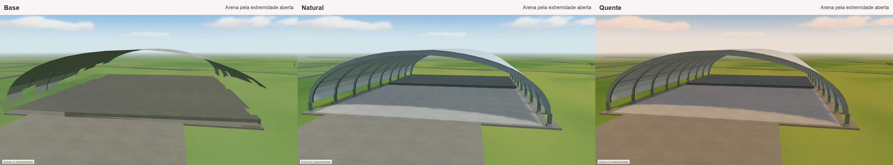
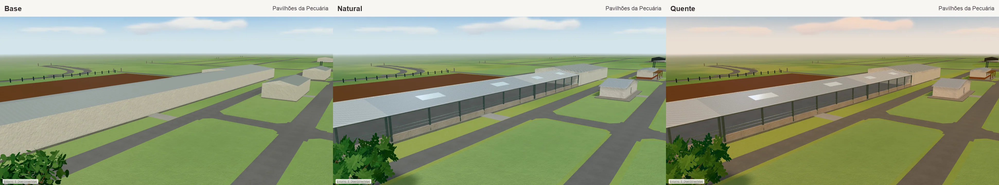

# Mapa comercial da Indumóveis · 17 de novembro de 2026

O Centro de Eventos ganhou um foyer recuado, a Arena passou a mostrar seus arcos até o piso e os três módulos da Pecuária passaram a ter vãos abertos e coberturas distinguíveis. O parque pode ser percorrido com luz Natural ou Quente, inclusive nos perfis gráficos leves. As 15 pranchas comparam a base e os dois modos com a mesma câmera, alvo, resolução e perfil. [Galeria antes e depois](validation/parque-2026-11-17/README.md)

## Ponto de partida e responsabilidades

A aplicação publicada identificava a revisão `5ff7d79` na abertura do trabalho. A branch principal já estava em `f667717`, com a correção posterior na ligação dos pavilhões 3 e 13. Esta última revisão foi compilada para as capturas e medições da base. Os dois builds foram servidos localmente com os mesmos dados de ensaio, sem sessão de produção. [Diferença entre publicação e base](https://github.com/leomateus620-pixel/indumoveis-connect/compare/5ff7d79aef53bf7bf58bf111c215fb2c9e7ad5ca...f6677174f300099442b3974da465ffabd5005998)

| Parte da cena | Responsabilidade verificada |
| --- | --- |
| `MapRenderer.tsx`, navegação e orçamento adaptativo | Ciclo de vida do WebGL, primeira cena, chegada dos grupos opcionais, picking, resolução e escolha de qualidade. |
| `permanentParkLayout.ts` e `permanentPark.ts` | Registro dos contornos e montagem da arquitetura contextual. As receitas de galpões e apoios foram separadas para respeitar os diferentes vãos e coberturas. |
| `architecture.ts`, `civicArchitecture.ts` e fachadas fotográficas | Pavilhões, anexos e superfícies de seleção. A geometria visual dos apoios mantém o vínculo comercial de cada edifício. |
| `visualTheme.ts`, `surfaceMaterials.ts`, `daylight.ts`, `daylightPalette.json`, `reflectionEnvironment.ts` e `solarShadows.ts` | Famílias físicas, cor de saída, céu, ambiente de reflexão e mapa solar. O novo controlador de iluminação atualiza os recursos existentes. |
| `vegetation.ts`, `parkLotPlanting.ts` e `urbanLandscape.ts` | Árvores instanciadas, plantio registrado, folgas e vegetação de rua e quintal. |
| `urbanLayout.ts`, referências urbanas, `parkRegistration.ts`, `pavement.ts` e `parkConnectivity.ts` | Transformação do parque e do exterior, geração do piso e prova de continuidade física. |

## Arquitetura, materiais e plantio

A Casa Fenasoja conserva os cinco volumes, com acesso escavado e caixilhos no pano triangular. O Palco Lactalis ganhou borda de tablado e estrutura até a cumeeira. Na Arena, nove arcos sustentam a cobertura orientada pela borda longa da planta. Na Pecuária, o ritmo de 5, 6 e 5 vãos diferencia as três seções de B9 e conserva as interfaces com os pavilhões vizinhos. Cozinha da Soja, Via Expressa, Churrascaria, Cooperativismo e Casa Rotária receberam soluções próprias. O inventário identifica as estruturas conferidas, as receitas preservadas e o grau de certeza de cada interpretação. [Inventário por estrutura](commercial-map-inventario-arquitetonico-2026-11-17.md)

As frentes de P3, P8 e P12 receberam ajustes nos vidros e peitoris. As receitas novas convertem o albedo escolhido para o espaço linear e compensam a cor de base do material na multiplicação por vértice. Chapa pintada, metal e vidro têm rugosidades e respostas especulares distintas da alvenaria. As peças compartilham materiais e os grupos estáticos são agregados por família. Perfis leves preservam as cores e simplificam o relevo. A grama e os campos externos mudam de tonalidade de forma contínua no terreno. [Materiais e atlas](commercial-map-pbr.md)

Oito árvores em setores de plantio mais amplo ganharam porte, preservando os centros e os limites laterais do cadastro. Os ramos terminam em grupos de folhas recortadas, com diferenças de orientação, luz e abertura. As versões perto e longe usam as mesmas extremidades e matizes. A geometria distante passa de 560 para 224 triângulos por copa. As árvores residenciais de folha larga usam oito ramos e quarenta grupos foliares dentro do orçamento original de 280 triângulos. Espécies, altura absoluta e contorno individual de copa são interpretações. [Árvores da Rua Brasil](validation/parque-2026-11-17/arvores.webp) · [Árvore junto ao Pavilhão 1](validation/parque-2026-11-17/copa.webp)

## Luz e sombras

Em **Opções de visualização → Iluminação**, Natural preserva o branco das coberturas. Quente dá tom dourado às faces ao sol e mantém preenchimento azulado nas faces em sombra. Sol, hemisférica, preenchimento, exposição, céu, reflexos e horizonte variam em conjunto. A preferência é local e independente da qualidade. A transição dura 180 ms e respeita a redução de movimento. A direção solar comum permite reutilizar a sombra ao alternar a temperatura. [Configuração e ciclo de vida](commercial-map-daylight.md) · [Comparação do horizonte](validation/parque-2026-11-17/horizonte.webp)

O perfil Detalhado encaixa o mapa solar estático de 1.024 × 1.024 nas construções e no plantio à medida que esses grupos chegam. As duas faces das coberturas abertas de chapa participam do passe de profundidade. A projeção de contato no tronco permanece e a copa deixa de receber uma segunda projeção escura. Os outros perfis usam as projeções econômicas. A navegação mede o contador de atualizações de sombra antes e depois de cada órbita. [Teste do volume de sombra](../src/features/commercial-map/solarShadows.test.ts) · [Teste das projeções](../src/features/commercial-map/parkContextShadows.test.ts)

## Território e cadastro

A imagem histórica Airbus de **19/11/2025**, consultada no Google Earth em **17/11/2026**, orientou o enquadramento territorial. A planta A2 identificou aberturas e circulação interna. Os dados vetoriais do OpenStreetMap identificaram as vias externas e seus nós de conexão. Foram recompostos três braços da rótula e a aproximação da RSC-472 ao Portão 5. A Benvenuto termina no Portão 3, com duas passagens pavimentadas entre os pilares até a circulação interna dos Imigrantes. O Portão 2 continua pedonal. A auditoria encontrou caminho para **73 de 73 âncoras**, além de verificar as duas passagens em A3 e o trajeto de A5. O recorte eliminou 113,89 unidades de desenho ao quadrado de pavimento sobreposto. [Fontes, transformações e limites de precisão](commercial-map-acessos-2026-11-17.md)

A comparação do cadastro com a base encontrou a mesma assinatura para os **68 lotes externos** e suas numerações, contornos, atributos, áreas declaradas e âncoras. O roteiro funcional usa busca, seleção e retorno do interior do Pavilhão 12. Os dados de ensaio são locais. A revisão só altera a apresentação e seus testes, sem migrações ou operações sobre negócios. [Assinaturas do cadastro](validation/parque-2026-11-17/cadastro.json) · [Percurso de seleção e iluminação](validation/commercial-map-daylight/lighting-interactions-2026-11-17.json)

## Medições e validação

Builds de produção locais, Chrome 157.0.8103.79, macOS Darwin 25.6.0, Apple M5 com dez núcleos lógicos, 16 GB e WebGL 2 via ANGLE/Metal. Cada condição teve três aberturas em contextos novos, cache HTTP desabilitado e órbita de 6,5 segundos, com DPR e escala interna fixados em 1 durante a comparação. A medição funcional de toque foi feita em viewport móvel no mesmo computador. Os números de abertura são medianas. Os valores de p95 são medianas dos três percentis por execução. As contagens de textura correspondem à vista inicial completa. [Amostras por execução](validation/parque-2026-11-17/medicoes.json)

| Indicador | Desktop detalhado · base → revisão | Móvel emulado leve · base → revisão |
| --- | ---: | ---: |
| Planta 2D utilizável (ms) | 619 → 632 | 615 → 614 |
| Primeiro quadro 3D utilizável (ms) | 836 → 852 | 833 → 831 |
| Cena completa no roteiro (ms) | 2.055 → 2.086 | 2.020 → 2.048 |
| Intervalo mediano de quadro (ms) | 16,7 → 16,7 | 16,7 → 16,7 |
| Intervalo p95 de quadro (ms) | 16,8 → 16,7 | 16,7 → 16,7 |
| Maior intervalo nas órbitas de 6,5 s (ms) | 16,8 → 33,3 | 16,8 → 33,3 |
| Maior tarefa longa na abertura (ms) | 399 → 365 | 435 → 365 |
| Chamadas de desenho no p95 | 170 → 169 | 126 → 129 |
| Triângulos no p95 | 342.738 → 270.532 | 266.223 → 183.608 |
| Texturas contabilizadas pelo WebGL | 14 → 16 | 11 → 13 |
| Memória de textura estimada (MiB) | 19,38 → 19,38 | 9,88 → 9,88 |

A janela desktop foi de 1.366 × 768, com buffer 3D de 1.294 × 655. A janela móvel foi de 390 × 844, com buffer de 390 × 689. A abertura ainda concentra tarefas de centenas de milissegundos. Na órbita adicional de **65 segundos** em Quente/Automática, o p95 foi de **16,7 ms** e o máximo foi de 16,8 ms nos 2.000 intervalos mais recentes retidos. A contagem de intervalos acima de 50 ms foi 0 nessa amostra. Em três saídas e reentradas, a contagem de contextos ativos voltou a zero ao sair e a um após a abertura. Cada reentrada completou o carregamento com 10.354.801 bytes estimados. O WebGL não fornece a ocupação física da VRAM nessa configuração.

O ensaio de interação atrasou a resposta do panorama e alternou os modos antes e depois da preparação. Seleção de lote, entrada e retorno do P12, qualidade gráfica, redimensionamento e a preferência local passaram no desktop e na emulação de toque. No teste complementar em SwiftShader, o perfil automático escolheu Leve. Com WebGL indisponível, a planta SVG permitiu selecionar um lote. O adaptador de ensaio local retornou 404 para recursos de marca da hospedagem e bloqueou as fontes remotas. O carregamento dos ativos da cena terminou sem falha de módulo opcional. [Percurso de interação](validation/commercial-map-daylight/lighting-interactions-2026-11-17.json) · [Software e contingência 2D](validation/parque-2026-11-17/modo-software-e-planta.json)

A suíte final passou com **659 testes em 98 arquivos**. O build de produção, a verificação TypeScript e o ESLint nos arquivos de código alterados passaram. Para reproduzir as capturas e órbitas, sirva o build com `scripts/serve-commercial-map-build.mjs` e execute `scripts/commercial-map-daylight-validation.mjs` com `MAP_BASE_URL` apontando para essa instância. O roteiro de interações usa a mesma URL em `scripts/commercial-map-lighting-interactions.mjs`.

## Origem dos recursos e limites

- Geometria, folhas, casca, superfícies e panorama são procedurais do projeto. O conjunto reaproveita a biblioteca Three.js, distribuída sob MIT, e o transcoder Basis já incorporado sob Apache 2.0. A documentação dos pavilhões registra as referências fotográficas e a origem dos detalhes gráficos preexistentes. [Atlas e geração](commercial-map-pbr.md) · [Licença do transcoder](../public/commercial-map/basis/LICENSE) · [Fotografias de referência](commercial-map-pavilion-photos-2026-11.md)
- A malha territorial usa dados de © OpenStreetMap contributors sob ODbL 1.0. A imagem do Google Earth/Airbus e a reconstrução complementar foram consultadas para relações espaciais e tipologias. As pranchas mostram renderizações do aplicativo. [Extrato e atribuição](commercial-map-acessos-2026-11-17.md)
- As alturas absolutas, os revestimentos das faces ocultas, parte dos vãos e os encontros internos da Pecuária dependem de levantamento de campo. A associação individual de P6/P10/P11 aos três módulos continua em aberto. O resíduo de 3,13 unidades de desenho no acesso leste limita a precisão local. Capacidade veicular, horários e condições de acesso dependem de confirmação com a operação do parque.
- A meta de 60 FPS no computador foi atingida durante as órbitas medidas. O ensaio em tela móvel cobre layout, interação e carga gráfica na GPU do M5. A meta de pelo menos 30 FPS em um Android ou iPhone intermediário físico continua pendente de medição nesse equipamento.
