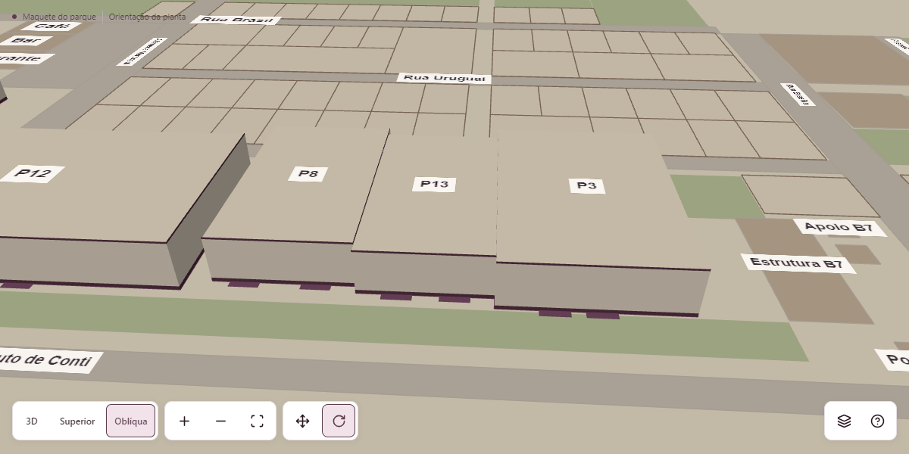
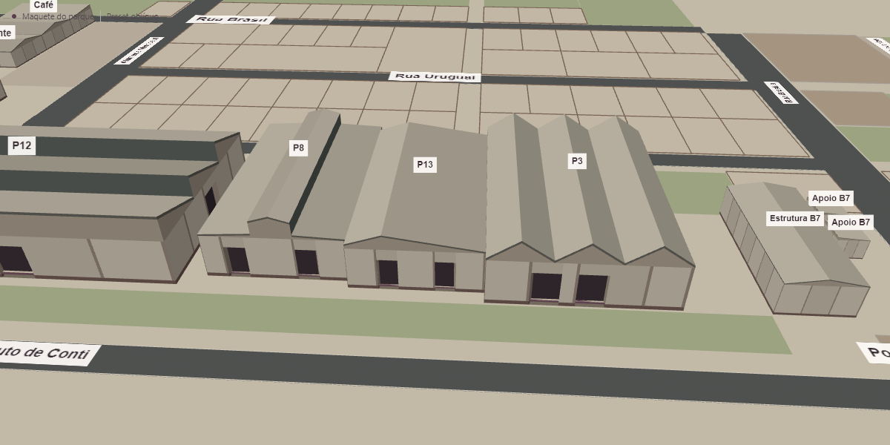
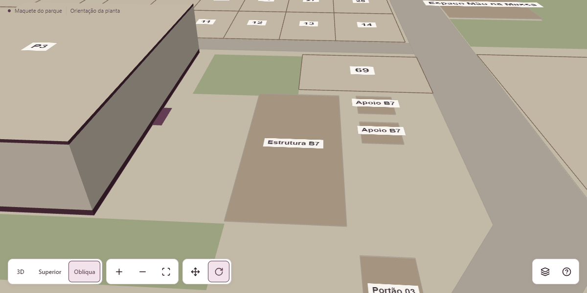
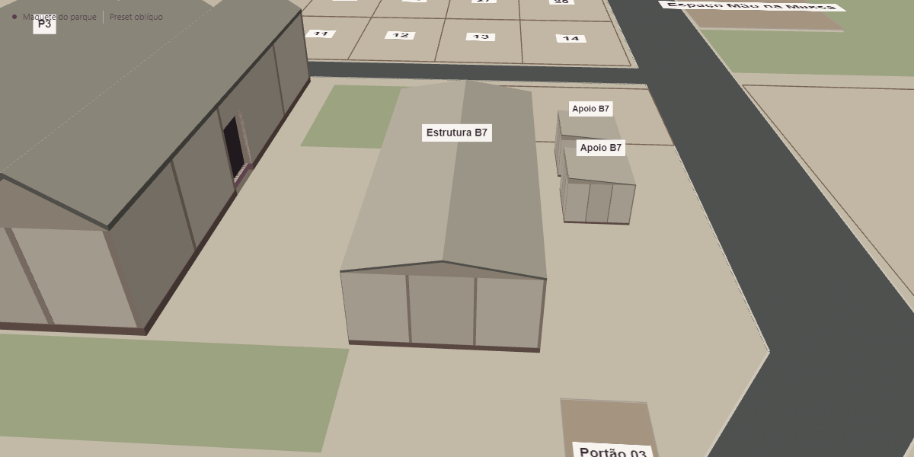
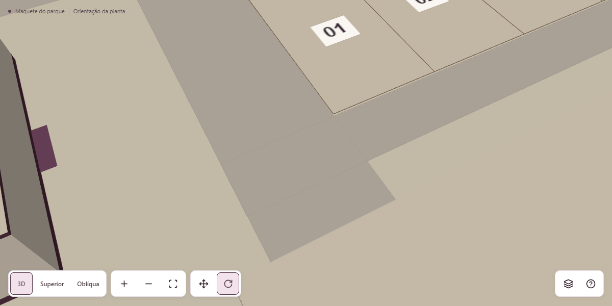
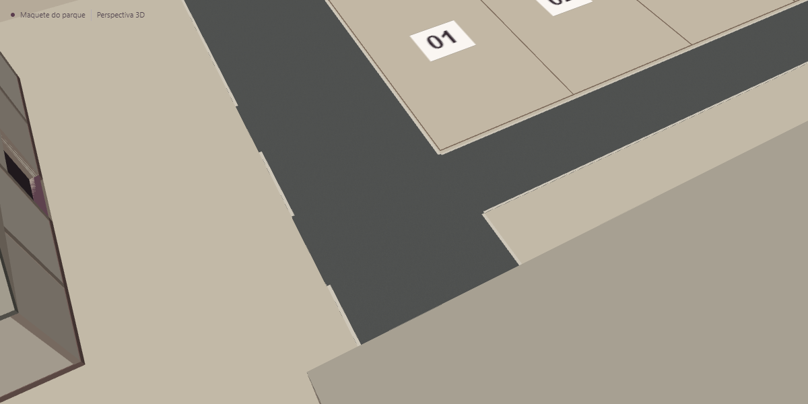

# Mapa Comercial Indumóveis — validação da etapa 2

Esta etapa evolui apresentação e navegação sobre a implantação aprovada. Mantém Three.js direto e OrbitControls, um único contexto WebGL por montagem, a rota `/mapa`, permissões, edição ativa, associações e situação comercial derivada. Não houve migração, publicação, escrita comercial de produção ou alteração do checkout FenaSoja.

**Estado deste relatório:** implementação, conservação territorial, matriz de navegador e medições concluídas no laboratório local. Os números da [etapa 1](commercial-map-validation.md) são históricos e não aprovam a cena arquitetônica atual.

## Diagnóstico e intervenção

O diagnóstico separou regras de interação, apresentação e custo de renderização. A presença de `PerspectiveCamera`, `enableDamping = false` ou iluminação Lambert, isoladamente, não explicava os problemas. A resposta direta dos gestos foi mantida; não foi acrescentada inércia sem um scheduler correspondente.

| Problema observado no estado anterior                              | Causa identificada e alteração                                                                                                                                                                                                                                                                                            |
| ------------------------------------------------------------------ | ------------------------------------------------------------------------------------------------------------------------------------------------------------------------------------------------------------------------------------------------------------------------------------------------------------------------- |
| Superior e inspeção impediam órbita                                | O renderer condicionava `enableRotate` à vista e à inspeção; mouse/toque eram forçados para pan, e a interface desabilitava outros presets. Esses bloqueios foram removidos. Os três presets orientam a mesma câmera e Mover/Girar funciona em todos, inclusive na inspeção.                                              |
| Interface continuava indicando uma vista exata depois do gesto     | Preset solicitado e orientação atual compartilhavam a indicação. A órbita passa a informar orientação livre, conservando o preset como comando reaplicável.                                                                                                                                                               |
| Inspeção restringia a troca de orientação                          | Fora da inspeção, a troca de preset já conservava alvo e distância. Essa regra foi preservada e estendida à inspeção, que antes forçava Superior. O foco agora também conserva a orientação manual corrente; reenquadrar continua uma ação separada.                                                                      |
| Um gesto durante transição podia herdar destino automático         | A transição passa a ter tipo explícito e o gesto assume a pose visível. Somente eventos de roda sucessivos podem acumular um destino de roda; preset/foco são interrompidos. Não há fila de voos.                                                                                                                         |
| Pan por botão não acompanhava a orientação girada                  | O deslocamento passou a usar as projeções dos eixos visíveis da câmera no chão e a distância corrente, em vez dos eixos fixos da planta.                                                                                                                                                                                  |
| Zoom e gestos perto dos limites tinham regras inconsistentes       | Roda/trackpad normalizam `deltaMode` e têm um único listener responsável; pinça e botões compartilham limites de distância, também contextualizados ao edifício. OrbitControls mantém zoom e pan de dois dedos. O alvo dispõe de margem contextual além do recorte cadastral, conservando um limite final de recuperação. |
| Controles inferiores competiam com mapa/ficha e reservas de câmera | Vistas, navegação e ações auxiliares foram compostas no cabeçalho, fora do Canvas. Em largura estreita usam seletores e menu superior. Reservas inferiores do antigo dock foram retiradas; permanece a reserva real da ficha.                                                                                             |
| Pavilhões eram paredes simples com tampa horizontal                | Um builder estático separado cria seis perfis estimados, espessura de parede e cobertura, painéis, embasamento e acessos recuados nas âncoras existentes. Não altera footprints nem cria portas oficiais para P14.                                                                                                        |
| Inspeção removia todo o shell                                      | Piso, paredes e estrutura passam a permanecer; somente cobertura e seus fechamentos superiores são ocultados. A volta restaura a pose externa salva sem recriar Canvas.                                                                                                                                                   |
| B7 e apoios conhecidos eram superfícies planas                     | B7, anexos, café, bar e restaurante recebem volumes proporcionais de apresentação. O preenchimento plano redundante é excluído. Eventos e Mão na Massa continuam áreas abertas; Portão 03 continua acesso no piso.                                                                                                        |
| Vias se confundiam com coberturas e lotes                          | A rede de pavimento usa asfalto neutro mais escuro, agregado sutil compartilhado e faixas trianguladas somente nas bordas expostas. Bordas internas e conexões ficam abertas; não há faixa central. Passeios conservam material e função pedonal distintos.                                                               |
| Picking, labels e foco ignoravam volumes de cobertura              | Alturas e bounds visuais são derivados separadamente do cadastro; o picking simplificado tem fachadas e footprint exato. Labels usam altura visual e orientação legível, e não apenas a altura territorial histórica.                                                                                                     |

Os percursos N01–N11, a regressao N11b e os cenarios de falha equivalentes a N12 enviam gestos reais e verificam pose/identidade/representação. Os resultados finais e as repetições justificadas estão registrados abaixo. Uma propriedade booleana habilitada não é, por si, aprovação de navegação.

## Conservação territorial e fontes

A assinatura SHA-256 dos atributos protegidos é idêntica antes e depois:

```text
c6d2ecb439fc39dd9ac449267472d99cf62b6e6fe50e9b7b7eed8668c70bb88b
```

O inventário atual confirmado é **59 envelopes externos para os 70 números**, sem individualizar os sete grupos agregados. A assinatura cobre IDs, polígonos, âncoras, números, grupos e acessos; o próprio arquivo territorial também conserva o SHA-256 `db70a5cb1362b3cfdeadfea02bfc2b8f54c497ad9c36216907174226886eaa11`. A revisão continua `2026-10-15`. Os modelos derivados não alteram o significado cadastral, áreas declaradas ou vínculos comerciais.

O complemento local `Prompt_Adicional_Indumoveis_Qualidade_Design_Navegacao_3D.md` foi considerado junto do pedido atual; as decisões mais recentes substituem a restrição de órbita em Superior/inspeção e a antiga localização inferior dos controles. Permanecem válidos os requisitos de resposta imediata, ficha 220/180 ms, preset 380 ms, foco 340–480 ms, acessibilidade, consulta independente e recuperação finita.

Os seis PDFs e a procedência da planta são descritos em [fontes](commercial-map-sources.md). As duas imagens WhatsApp desta etapa mostram o produto anterior e não comprovam elevação real. O código arquitetônico FenaSoja foi consultado somente para leitura: perfil B1→P1, B2→P14, B3→P12, B4→P8, B5→P13 e B6→P3. Não foram transplantados coordenadas, facing, dados comerciais, atividades, estandes ou dependências gráficas. Os perfis de cobertura são aproximações estimadas, sem alegação de fidelidade arquitetônica real.

As proporções locais, recorte de P12, classificação dos apoios e pendências de elevação estão em [arquitetura](commercial-map-architecture.md). A topologia das bordas expostas e seus parâmetros de desenho estão em [pavimentação](commercial-map-pavement.md). Nenhuma proporção esquemática foi convertida para metros ou área comercial.

## Verificação técnica

- Suíte do projeto: **61/61 testes passando**, incluindo os testes novos de arquitetura e pavimento, e os testes territoriais e de navegação existentes.
- TypeScript: passou com `node node_modules/typescript/bin/tsc --noEmit`.
- Build de produção: passou; engine permanece em chunk dinâmico. A auditoria de bundle existente continua responsável por verificar isolamento de Financeiro/Documentos.
- Lint do escopo alterado: passou. Isso não significa que o projeto inteiro tenha lint limpo.

O lint global da etapa 1 registrava 17.158 erros, dos quais 17.157 eram de formatação, e 12 avisos. A amostra global de fonte executada durante esta etapa registrou 16.937 erros/12 avisos: 16.936 de formatação e o mesmo `prefer-const` histórico de `previewAuthStorage.ts:38`. As regras dos avisos permaneceram as mesmas: nove `react-refresh/only-export-components`, um `react-hooks/exhaustive-deps` e dois avisos de diretivas de supressão não utilizadas. Essa amostra precede a formatação final de trechos do harness/diagnóstico; sua contagem não substitui o lint final do escopo.

A execução literal de `eslint .` foi interrompida porque incluía bundles e evidências gerados em `artifacts.local`. A repetição acrescentou somente `--ignore-pattern artifacts.local/**`; não suprimiu regras nem excluiu fontes do produto. O projeto inteiro não foi reformatado para apagar dívida histórica.

## Protocolo de comparação visual

O baseline foi extraído do HEAD anterior às alterações, `e9118ad` (mesma arvore territorial do merge `b22b2ef` em main), em uma cópia local isolada. Nessa cópia, a única intervenção no renderer acrescentou diagnóstico de pose e `setReferencePose`, disponível somente quando `mapDiagnostics=1`. O setter cancela a transição, aplica a pose fornecida e invalida um draw; não muda controles, materiais ou composição. O produto atual usa o mesmo instrumento diagnóstico para reprodução dos pares.

Os pares antes/depois devem usar **Canvas de 1200×600**, o mesmo alvo, posição de câmera, distância, perfil e orientação. O recorte é do Canvas, para que a mudança da localização da toolbar não simule melhoria por aproximação. Os JSONs de referência conservam a pose exata aplicada, viewport e condições; imagens sem pose equivalente não aprovam ganho arquitetônico. Capturas concluídas: parque geral, pavilhões 8/13/3, Mostra/P12, B7 e cruzamento de asfalto. A inspeção tem evidência própria de cobertura oculta e estrutura preservada.

O laboratório usa build de produção servido localmente e fixtures interceptadas de autenticação/REST, edição de teste e zero espaços comerciais persistidos. Mutações reais são bloqueadas. Não é sessão de produção nem validação de RLS remota. Chromium automatizado e GPU Intel do host só podem ser declarados como condições efetivas quando o JSON registrar `unmaskedRenderer` obtido **do mesmo contexto WebGL da cena**, junto de navegador, resolução, DPR e perfil. Não é criado outro contexto permanente para inferir GPU.

## Resultados medidos

Host real: Windows 10.0.26200, Intel Core i5-1035G1, 4 processadores lógicos, 8 GiB RAM; Chromium **153.0.8010.12**, ANGLE Direct3D11 sobre **Intel UHD Graphics (0x8A56)**, identificado no próprio contexto da cena. Os percursos de desempenho usaram viewport 1366×768, Canvas 1294×664, DPR efetivo 1 e 859.216 pixels de buffer. As entradas mobile usam viewport/emulação e a mesma GPU; CPU ×4 é throttling, não telefone físico.

A [rodada ampla](validation/commercial-map-stage2/browser-full.json) passou **49/49** verificações. A [repetição final](validation/commercial-map-stage2/browser-final.json) passou **33/33**, incluindo N11b, cruzamento em close, gesto SVG longo, contexto perdido e aba oculta. O [handoff final](validation/commercial-map-stage2/browser-handoff.json) passou **7/7**, repetindo as entradas, as falhas e as capturas após os ajustes finais. Nenhum erro JavaScript/hidratação foi registrado. Recusas de fontes externas e respostas de falha injetadas ficam identificadas nos logs e não representam falha de renderização.

| Percurso | Resultado observado                                                                                                                                                     |
| -------- | ----------------------------------------------------------------------------------------------------------------------------------------------------------------------- |
| N01      | Primeira representação estável é WebGL em perspectiva; SVG temporário é identificado e retirado quando pronto.                                                          |
| N02–N04  | Superior permite inclinar/orbitar; presets conservam alvo/distância/seleção; órbita completa supera 360° acumulados sem barreira de azimute ou inversão.                |
| N05      | Os seis pavilhões foram inspecionados, girados e aproximados; piso/parede/estrutura permanecem e a pose externa retorna com erro abaixo de 0,2 unidade de desenho.      |
| N06–N08  | Gesto interrompe preset na pose visível; roda, +/− e pinça compartilham limites; pan acompanha os eixos visíveis.                                                       |
| N09–N11  | Seleção e Canvas sobrevivem a sidebar/orientação; picking real acerta fachada de Mostra e B7; toolbar/popovers não selecionam atrás nem bloqueiam o restante da cena.   |
| N11b     | Um toque mantido é cancelado ao acionar zoom no cabeçalho; movimento/soltura antigos não corrompem o destino; novo gesto funciona.                                      |
| N12      | WebGL ausente, chunk recusado, erro comercial e contexto perdido têm consulta/fallback finitos, sem inventar status; movimento reduzido e aba oculta foram exercitados. |

Os seis tamanhos 360×800, 390×844, 844×390, 768×1024, 1366×768 e 1920×1080 passaram com busca, ficha, inspeção e tela cheia. Não houve dock inferior, overflow horizontal ou controle de cabeçalho abaixo de 44×44 px. A área inicial livre ficou entre **85,7% e 94,4%**, acima de 80%. As capturas responsivas documentam composição; os pares de arquitetura abaixo usam câmera equivalente separadamente.

Após um ciclo de aquecimento e **20 ciclos medidos** de presets/inspeção/retorno, os contadores permaneceram em **28 geometrias, 2 texturas e 6 programas**, na mesma instância. Dez saídas/reentradas encerraram o contexto próprio ao sair. Nas **30 seleções** com dados locais, p95 de reconhecimento DOM foi **1,3 ms** e de draw submetido **13,4 ms**; ambos abaixo de 150 ms. Esses valores não medem input-to-photon nem latência do banco remoto.

### Carregamento

Cinco entradas frias e cinco aquecidas por cenário, **10 Mbps/RTT 80 ms**. Cache frio usa contextos novos; aquecido significa reentrada SPA com chunks avaliados, sem supor cache HTTP sob interceptação. Valores são mediana / pior caso. Todos os cenários conservaram 3D utilizável, medido separadamente do SVG útil.

| Cenário · n=5             | Representação útil |  3D utilizável | 3D pronto |
| ------------------------- | -----------------: | -------------: | --------: |
| CPU normal · fria         |     1584 / 2064 ms | 1590 / 2071 ms |       5/5 |
| CPU normal · SPA aquecida |       102 / 169 ms |   269 / 286 ms |       5/5 |
| CPU ×4 · fria             |     1858 / 1900 ms | 2498 / 2538 ms |       5/5 |
| CPU ×4 · SPA aquecida     |     1345 / 1495 ms | 1705 / 1851 ms |       5/5 |

A meta de consulta útil ≤3 s com CPU normal e ≤5 s no cenário reduzido passou. O watchdog de 4,5 s conta somente preparação visível e sem gesto SVG ativo. A regressão segura um gesto real durante 5 s após três draws e confirma apresentação 3D ao soltar, conservando o alvo. A pausa de aba usa injeção explícita de visibilidade porque abas headless não reproduziram a ocultação nativa.

### Navegação ativa e orçamento

Cada linha mede **30 s** de entrada real automatizada, com rotação/arrasto e roda. Não foram excluídos intervalos ruins. Os vetores completos `frameIntervals`/`renderDurations` estão em linhas compactas nos JSONs; a compactação foi conferida por igualdade integral dos valores. FPS deriva da cadência de draws submetidos durante atividade; não comprova apresentação física no monitor. Ociosidade sob demanda não é contada como queda de FPS.

| Perfil / cenário                            | FPS mediano | Intervalo p95 | Pausas >200 ms | Pico draws | Pico triângulos |
| ------------------------------------------- | ----------: | ------------: | -------------: | ---------: | --------------: |
| Leve · parque                               |       59.88 |       16.8 ms |              0 |         28 |            7642 |
| Equilibrado · parque                        |       59.88 |       16.8 ms |              0 |         28 |            7766 |
| Leve · lote 70                              |       59.88 |       16.8 ms |              0 |         18 |            6992 |
| Leve · 8/13/3                               |       59.88 |       16.8 ms |              0 |         18 |            7080 |
| Equilibrado · 8/13/3                        |       59.88 |       16.8 ms |              0 |         18 |            7080 |
| Leve · B7                                   |       59.88 |       16.8 ms |              0 |         18 |            6972 |
| Equilibrado · B7                            |       59.88 |       16.8 ms |              0 |         17 |            6946 |
| Leve · cruzamento Argentina/Mercosul        |       59.88 |       16.8 ms |              0 |         13 |            6862 |
| Equilibrado · cruzamento Argentina/Mercosul |       59.88 |       16.8 ms |              0 |         13 |            6862 |

Todos passaram ≥30 FPS no Leve e ≥50 no Equilibrado; p95 do Leve ≤50 ms. Os picos são coletados por rodada do percurso, com o frame completo e todos os batches, não apenas o último mesh. Texturas estimadas: **4.216.150 bytes (~4,02 MiB)**, duas texturas residentes; DPR 1 e 859.216 pixels ficaram abaixo dos tetos. Nenhum perfil remove a forma dos telhados ou achata apoios.

Em overview com pose exatamente igual, a [comparação visual instrumentada](validation/commercial-map-stage2/visual-pairs.json) registrou **44 → 28 draws** e **780 → 7.636 triângulos**. Isso descreve o gasto/ganho geométrico, não prova sozinho fluidez. A [auditoria de bundle](validation/commercial-map-stage2/bundle.json) mediu **176.403 bytes gzip** incrementais; Financeiro e Documentos continuam sem importar ou solicitar a engine.

A [comparação adicional no mesmo host/GPU e pose inicial](validation/commercial-map-stage2/equivalent-benchmark.json) repetiu 30 s de overview em Leve e Equilibrado antes/depois: ambos ficaram em **59,88 FPS**, p95 **16,8 ms** e **zero pausas >200 ms**, com Canvas/buffer iguais e erro de pose abaixo de 10⁻⁶. A melhora geométrica manteve a cadência medida; não se atribui ganho percentual de FPS em um ensaio limitado à cadência do navegador.

### Comparação visual

Os [seis pares](validation/commercial-map-stage2/visual-pairs.json) têm erro de posição/alvo **zero** na precisão registrada, Canvas 1200×600 e perfil Leve; as [poses antes](validation/commercial-map-stage2/before-poses.json) e [depois](validation/commercial-map-stage2/after-poses.json) permitem auditoria. O [patch diagnóstico do baseline](validation/commercial-map-stage2/baseline-instrumentation.patch) torna a instrumentação revisável (`git apply --unidiff-zero` na cópia do baseline). A toolbar antiga continua aparecendo no Canvas anterior porque fazia parte daquele layout.

| Antes: pavilhões 8/13/3 e B7                                    | Depois: mesma câmera                                            |
| --------------------------------------------------------------- | --------------------------------------------------------------- |
|  |  |

| Antes: B7                                                   | Depois: B7 sem função inferida                              |
| ----------------------------------------------------------- | ----------------------------------------------------------- |
|  |  |

| Antes: cruzamento Argentina/Mercosul                                                | Depois: asfalto e bordas abertas                                                    |
| ----------------------------------------------------------------------------------- | ----------------------------------------------------------------------------------- |
|  |  |

Outros pares: [overview antes](validation/commercial-map-stage2/before-overview.png)/[depois](validation/commercial-map-stage2/after-overview.png), [Mostra antes](validation/commercial-map-stage2/before-P1.png)/[depois](validation/commercial-map-stage2/after-P1.png), [P12 antes](validation/commercial-map-stage2/before-P12.png)/[depois](validation/commercial-map-stage2/after-P12.png).

Interface: [desktop antes](validation/commercial-map-stage2/before-desktop.png)/[depois](validation/commercial-map-stage2/after-desktop.png), [mobile antes](validation/commercial-map-stage2/before-mobile.png)/[depois](validation/commercial-map-stage2/after-mobile.png), [paisagem antes](validation/commercial-map-stage2/before-landscape.png)/[depois](validation/commercial-map-stage2/after-landscape.png). Há também [inspeção P8](validation/commercial-map-stage2/inspection-P8.png) e [órbita saindo de Superior](validation/commercial-map-stage2/top-free-orbit.png).

### Falhas preservadas e reprodução

O [baseline atual reproduzido](validation/commercial-map-stage2/baseline-reproduced.json) falhou em dois cenários esperados: arrastar em Superior não alterou a orientação, e manter o gesto SVG além de 4,5 s ativou 2D indevidamente. Ambos passaram na repetição final. A [rodada exploratória](validation/commercial-map-stage2/exploratory-navigation.json) preserva dois timeouts do harness ao escolher B7 por texto de localização de outro resultado; o seletor passou a exigir rótulo exato, e picking/capturas B7 passaram depois. Não foi removido um teste nem aumentado timeout para aprovar o produto.

Use o build de produção e o harness existente descritos em [interação](commercial-map-interaction.md). `MAP_CHECK_FILTER` seleciona jornadas; `MAP_ARTIFACT_DIR` separa saídas; `MAP_BROWSER_GPU=hardware` solicita GPU, cuja identidade deve ser conferida no JSON. `MAP_REFERENCE_POSES=<after-poses.json>` aplica poses equivalentes às capturas, e `MAP_BENCH_POSES=<relatorio.json>` reaplica a pose inicial de um benchmark equivalente. A auditoria de fonte aceita o caminho de `territory-before.json` como terceiro argumento; a de bundle aceita o caminho JSON de saída, preservando evidências históricas.

## Limites mantidos

Não estão certificados Android físico, iPhone/Safari, teclado virtual real, trackpad físico, temperatura, bateria, usuários externos, rede/CDN de produção ou operação autenticada/RLS remota. Alturas reais, elevações das coberturas, acesso exato de P14, subdivisões pendentes e associações cadastrais não fornecidas continuam pendentes. A melhoria de apresentação não preenche essas lacunas com empresas, preços, status ou métricas oficiais inventados.
