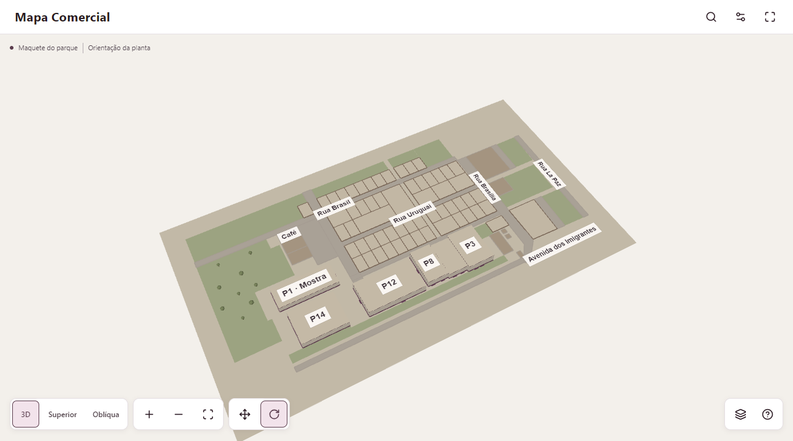
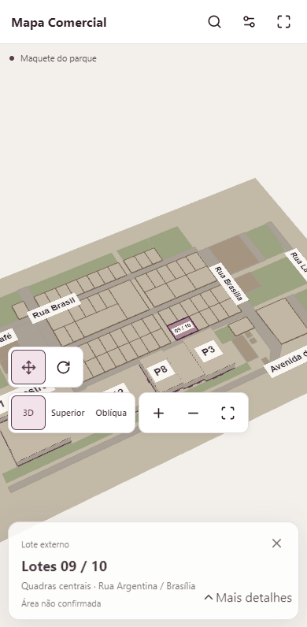
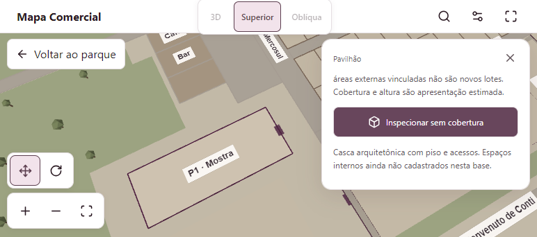
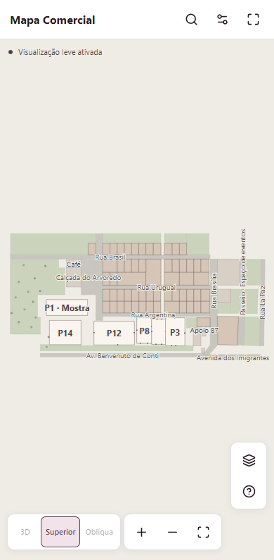

# Mapa Comercial Indumóveis — validação

## Direção de arte — materiais, ambiente e operação

O relatório vigente desta evolução está em [validação da direção de arte](commercial-map-art-direction-validation.md), acompanhado da [linguagem visual e tokens](commercial-map-art-direction.md). Os relatórios abaixo preservam evidência histórica das etapas anteriores e não substituem a medição da cena atual.

## Etapa 2 — apresentação e navegação 3D

O relatório atual está em [validação da etapa 2](commercial-map-stage2-validation.md), com diagnóstico, conservação territorial, verificação técnica e resultados da nova cena. Os contratos vigentes estão em [operação](commercial-map-interaction.md), [arquitetura estimada](commercial-map-architecture.md) e [pavimentação](commercial-map-pavement.md).

## Resultados históricos da etapa 1

O conteúdo abaixo registra a implementação inicial e suas medições históricas. Não certifica o desempenho, a arquitetura nem a posição dos controles após a etapa 2. Em particular, 44 draw calls e as contagens antigas de triângulos pertencem à cena simples anterior.

Implementação local em branch própria, sem migração, publicação, alteração comercial ou escrita no projeto FenaSoja. A rota `/mapa` mantém autenticação, permissões e links `space`, `deal` e `status`. O laboratório usa autenticação e REST interceptados, com edição de teste e zero espaços cadastrados; não comprova a operação autenticada do banco de produção.

## Entrega e fidelidade

O parque possui **59 envelopes externos com os 70 números da planta**, seis edifícios (1, 3, 8, 12, 13 e 14), vias, apoios e bosque reduzido. Mostra/1 e 14 permanecem separados. Os sete grupos agregados conservam exatamente seus membros, sem divisórias inventadas. O inventário, hashes, controles, diferenças de áreas e comparação rejeitada com coordenadas FenaSoja estão em [fontes](commercial-map-sources.md).

A planta geral foi conferida visualmente e por sobreposição privada dos vetores extraídos aos seus pontos PDF. A transformação preserva a orientação da folha, sem espelho. O desenho é esquemático: unidades de desenho e alturas estimadas não são medidas topográficas. Não foram incluídos nomes ou logos de expositores, preços, reservas ou disponibilidade inferida da cor impressa.

São funcionais busca por número/membro de grupo, localização e via; seleção; três vistas; pan, zoom e órbita; enquadramento; inspeção sem cobertura e retorno à pose externa; ficha responsiva; teclado; tela cheia com expansão interna; perfis gráficos e consulta SVG independente da engine. Os interiores não contêm estandes fictícios. Contratos e comportamento estão em [operação e reprodução](commercial-map-interaction.md).

## Laboratório de navegador

Build de produção existente, servido localmente pelo adaptador Cloudflare do repositório. Host: Intel Core i5-1035G1, Intel UHD Graphics, 4 processadores lógicos, 8 GiB RAM, Windows 10.0.26200. Chromium automatizado; viewport móvel é emulação. A identificação do renderer foi lida no **mesmo contexto da cena**, sem criar contexto permanente de teste.

As evidências JSON registram versão do navegador, condições, amostras e critérios: [matriz final Intel](validation/commercial-map/browser-validation.json), [repetição do handoff](validation/commercial-map/handoff-repeat.json), [revisão final do SVG/aberturas](validation/commercial-map/svg-layer-repeat.json) e [fluxo longo SwiftShader](validation/commercial-map/software-flow.json). Uma primeira rodada exploratória tinha contexto de CPU reduzida ainda aberto e foi classificada como não comparável. **Uma segunda rodada longa SwiftShader também ficou em 20 FPS com CPU explicitamente normalizada**; essa falha é preservada, com causa não isolada. Não há remoção seletiva de frames lentos das rodadas válidas. O equipamento de referência desta entrega é a GPU Intel identificada, com ensaio completo separado, Chromium 153.0.8010.12.

### Layout e interação

Foram exercitados 360×800, 390×844, 844×390, 768×1024, 1366×768 e 1920×1080, incluindo busca, seleção, ficha, inspeção e tela cheia. A área livre inicial medida permanece acima de 80% abaixo do cabeçalho global, incluindo 81,32% em 844×390, com alvos mínimos de 44×44 px e sem overflow horizontal.

As jornadas incluem 30 seleções, 20 fechamentos, 20 trocas de vista e 20 ciclos de inspeção, além de saída/reentrada. Canvas e contexto permanecem os mesmos nos ciclos; recursos estabilizam. Ao sair, contextos e loops ativos chegam a zero. Fechar ficha conserva câmera/inspeção; retornar ao parque restaura a vista externa.

Também foram verificados clique real por projeção do item, arrasto sem seleção, interrupção de transição, cancelamento, blur, teclado/Esc/foco, resize pela sidebar, pinça sintética CDP e mudança de orientação. Duas abas headless não alteraram `document.hidden`; ocultação/retorno foi **simulada explicitamente** por estado/evento de visibilidade, confirmando pausa, cancelamento e exclusão do intervalo oculto. Os testes de falha cobrem WebGL indisponível, chunk recusado, API comercial com erro e perda de contexto: a seleção e a consulta continuam disponíveis, com recuperação finita e sem tela preta ou recarga automática. Uma folha de fontes atrasada em 5 s não impediu a primeira consulta, medida em 644 ms nesse cenário.

### Carregamento e fluidez

Os valores finais e suas condições constam nos JSONs anexos. Entrada útil significa geometria e controles disponíveis; marcas separadas registram chunk, criação do renderer, draw válido e controles. DOM atualizado e draw submetido não medem input-to-photon.

Rede CDP: 10 Mbps/RTT 80 ms. Cinco entradas frias em contextos novos e cinco reentradas SPA aquecidas por cenário, com chunks já avaliados; interceptação desabilita cache HTTP. CPU4 é redução sintética da CPU do mesmo host/GPU, não outro aparelho.

| Representação útil              |  Mediana | Pior caso |      Meta | Resultado |
| ------------------------------- | -------: | --------: | --------: | --------- |
| CPU normal, fria (n=5)          | 1.547 ms |  1.633 ms | ≤3.000 ms | passou    |
| CPU normal, reentrada SPA (n=5) |   115 ms |    196 ms | ≤3.000 ms | passou    |
| CPU4, fria (n=5)                | 1.810 ms |  1.838 ms | ≤5.000 ms | passou    |
| CPU4, reentrada SPA (n=5)       | 1.413 ms |  1.589 ms | ≤5.000 ms | passou    |

| Navegação ativa Intel UHD, 30 s cada | FPS mediano | Intervalo p95 | Pausas >200 ms |
| ------------------------------------ | ----------: | ------------: | -------------: |
| Leve, parque inteiro                 |       59,88 |       16,8 ms |              0 |
| Equilibrado, parque inteiro          |       59,88 |       16,8 ms |              0 |
| Leve, próximo ao lote 70 após ciclos |       59,88 |       16,8 ms |              0 |

Os três trechos passaram as metas de ≥30/≥50 FPS e p95 ≤50 ms. Overview: 44 draw calls, 782 triângulos em Leve/902 em Equilibrado, uma textura estimada em 4 MiB. Nas 30 seleções, p95 até atualização DOM foi **1,4 ms**, e até draw submetido foi **14,4 ms**; ambos abaixo de 150 ms, sem equivaler a apresentação física no monitor.

O ensaio longo SwiftShader manual falhou a meta de fluidez, com 20 FPS e p95 próximo de 50,1 ms; não é apresentado como aprovado. Em AUTO, um teste separado com cadência lenta simulada confirmou a passagem direta para 2D após três janelas ruins já em Leve, preservando seleção/alvo e encerrando o único contexto, sem retry. O modo 3D manual continua disponível por escolha explícita.

O teste controlado de abertura avançou três draws reais enquanto o SVG era arrastado: o 3D aguardou o fim do gesto e conservou o último alvo. A primeira execução desse teste ficou presa no polling RAF do próprio harness, que também congelava RAF; a repetição com polling independente de 20 ms passou. Isso foi uma correção do laboratório, sem excluir falha reproduzível do produto.

A [auditoria de arquivos emitidos](validation/commercial-map/bundle.json) mede **169.866 bytes gzip (~0,162 MiB)** incrementais, descontando o shell já carregado, abaixo de 3 MiB. É medição estática dos artefatos, não tráfego de produção. Engine final `MapRenderer-BGI3RIOg.js`: chunk dinâmico; Financeiro e Documentos não importam nem solicitam o renderer em entrada direta. Não há raster, modelo ou textura externa no caminho inicial. A cena usa materiais compartilhados, instancing, desenho sob demanda e tetos de pixels por perfil.

## Verificação técnica e limites

`npm test`: **47/47**; TypeScript com `node node_modules/typescript/bin/tsc --noEmit`: passou; build de produção: passou. Lint do escopo novo: passou; a API passou aceitando seus EOLs existentes com `endOfLine:auto`. O lint global já falhava na base por formatação/EOL e um `prefer-const` preexistente em `previewAuthStorage.ts`; não foi reformatado o projeto inteiro. A [medição da base](validation/commercial-map/baseline-lint.json) registra 17.338 erros e 12 avisos; a [execução atual](validation/commercial-map/technical-checks.json) registra 17.158 erros (17.157 de formatação) e os mesmos 12 avisos.

Pendências reais: subdivisão dos sete grupos; áreas não declaradas de 57/69/70; porta exata do pavilhão 14; alturas e levantamento cadastral; associações comerciais por edição/setor/UUID ainda não fornecidas. Sem associação, o mapa informa situação não confirmada e trata links recebidos com aviso, sem converter UUID em número.

Não foram testados Android físico, iPhone/Safari, teclado virtual real, trackpad físico, temperatura/bateria ou usuários externos. Firefox/WebKit não estavam disponíveis no runtime consultado e não foram executados. O benchmark da GPU Intel do host não substitui esses testes. Acesso real/RLS remotos, latência de produção e efeitos de CDN também não são certificados pelo laboratório interceptado.
