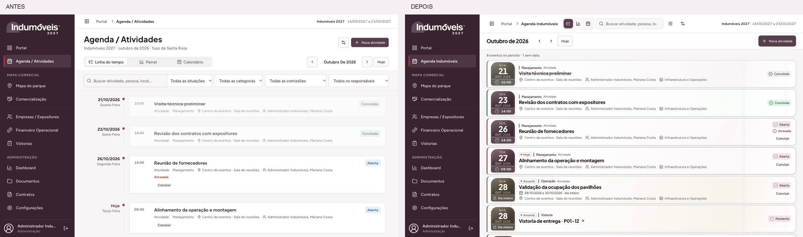

# Agenda Indumóveis — reorganização da área de trabalho

Validação em 27/10/2026. A revisão final compacta a lista para mostrar seis eventos completos no notebook, preservando a identidade arquitetônica. [Relatório da densidade e comparação direta](density/README.md). Implementação na branch `codex/portal-integrado`, destinada à PR #9, preservando as alterações anteriores do portal.

## Comparação visual real

- [1366 × 768](comparison-1366.jpg)
- [1440 × 900](comparison-1440.jpg)
- [390 × 844](comparison-390.jpg)

As duas versões executam os componentes reais do repositório com o mesmo conjunto local de validação: seis atividades, uma vistoria e um vencimento, incluindo conclusão, cancelamento, atraso, intervalo de vários dias e atividade sem data. O baseline foi extraído do commit `5904289`. Os dados são sintéticos; as imagens não representam registros reais nem implantação em produção. O harness está em `artifacts.local/`, ignorado pelo Git, sem rota de teste ou alteração da autenticação no aplicativo.

Os anexos fornecidos e os componentes CronogramaModuleShell, CronogramaTimelineBoard, EventCards, CronogramaFiltersTrigger e CronogramaHeaderSearch do repositório local expo-logistics-hub orientaram a hierarquia. A implementação usa composição React tipada no AppShell, sem transferências manuais de DOM ou cópias ocultas de comandos.

| Viewport CSS |       Cabeçalho principal | Primeiro evento (y) | Largura do evento | Overflow horizontal | Barras de comandos / Nova atividade |
| ------------ | ------------------------: | ------------------: | ----------------: | ------------------- | ----------------------------------- |
| 1366 × 768   |                     64 px |              158 px |           1062 px | Não                 | 1 / 1                               |
| 1440 × 900   |                     64 px |              158 px |           1136 px | Não                 | 1 / 1                               |
| 390 × 844    | 137 px, com reorganização |              296 px |            362 px | Não                 | 1 / 1                               |

[Medidas brutas](measurements.json). A primeira lista no notebook começa aproximadamente 125 px acima do baseline. As capturas foram realizadas pelo navegador com zoom de página 100%; o Chrome foi utilizado para controlar o viewport com precisão, pois a superfície interna mantém zoom próprio. A prévia interna também foi aberta. Não foi usado Playwright externo ao Browser Use.

## Superfícies e interações

- [Filtros desktop](filters-1366.jpg) e [painel mobile](filters-390.jpg): rótulos, critérios selecionados, contagem e limpeza. Busca/situação/categoria/comissão/responsável são controlados pelos parâmetros de URL existentes, preservados entre as três visualizações.
- A combinação Planejamento + Infraestrutura e Operações + Minhas atividades retornou quatro registros no fixture. O responsável anterior é ignorado enquanto Minhas atividades está ativo; o controle explica que considera atribuição direta, inclusive adicional.
- Escape fecha popover/Sheet e devolve foco ao acionador. Não há deslocamento dos eventos causado pela abertura dos filtros. Os testes também cobrem contenção de foco no painel móvel e estabilidade do input de busca durante atualizações do slot.
- [Detalhes desktop](details-1366.jpg), [detalhes mobile](details-390.jpg), [edição desktop](edit-1366.jpg) e [edição mobile](edit-390.jpg): programação e duração, local, responsável principal e demais responsáveis, comissões, descrição única e documentos. Painel lateral com 768 px no desktop; corpo com rolagem e ações estáveis.
- Detalhes → Editar → Voltar → Escape mantém o evento e os critérios, abre um único diálogo por vez e retorna o foco ao título do evento. O rodapé de edição mobile ocupa y=758–835 px em 390 × 844.
- Refetch não apaga rascunho nem troca a versão esperada da sessão de edição. Reabrir captura a versão atual. Idempotência de criação, validações e proteção de descarte permanecem.
- [Calendário mobile](calendar-390.jpg) e [desktop](calendar-1366.jpg): intervalo de vários dias aparece nos dias correspondentes sem duplicar o cadastro; há lista separada para atividades sem data. Selecionar célula de mês adjacente atualiza também o mês da URL.
- [Sem eventos](empty-390.jpg) e [sem resultados](no-results-390.jpg) têm mensagens distintas. A limpeza recuperou os oito eventos e manteve mês/visualização. Há uma única ação Nova atividade.
- [Somente leitura](read-only-390.jpg): sem cadastro, catálogos, alteração de situação ou edição; documentos respeitam permissão própria. Vistorias e financeiro só entram na agregação quando seus módulos são autorizados. Seus links usam `/vistorias/:id` e `/financeiro`; a página financeira existente abre o módulo, sem seleção específica de parcela.
- A navegação para Dashboard removeu todos os comandos da Agenda e restaurou o cabeçalho comum de 48 px.
- [Texto ampliado](text-200-390.jpg): raiz tipográfica a 200% em 390 px, sem overflow. O breadcrumb quebra linhas; não há corte de título nem compressão dos controles. O calendário usa contagens compactas em telas estreitas e detalhes abaixo.
- Movimento reduzido conferido por emulação: animações do overlay e painel desativadas; `transition-property: none` nos primitivos portaled. Transições normais de filtros ficam em 180 ms. As fontes e tokens existentes Figtree/Plus Jakarta Sans, ameixa, vermelho e taupe foram preservados.

## Refinamento arquitetônico dos eventos

Os marcadores de data foram compactados para **82 × 81 px** no desktop, preservando o nicho e os ponteiros reais. No celular, o suporte usa 76 px de largura e a composição cresce conforme o conteúdo. O nicho em arco reaproveita a linguagem do contador: profundidade por gradientes, iluminação lateral discreta, moldura interna e faixa metálica. Os cards normais do desktop têm **94 px**, com crescimento natural pelo conteúdo e intervalo de 6 px. Títulos de 16 px e metadados de 12 px mantêm a leitura. Os suportes dos títulos foram refinados e superfícies ganharam arcos de fundo sutis e bordas refinadas. Nenhum recurso 3D ou dependência foi adicionado.

[Comparação da densidade final](density/comparison-1366.jpg). As capturas gerais antes/depois acima já mostram a versão final.

[Hoje e amanhã no desktop](today-tomorrow-1366.jpg) e [página mobile completa](today-tomorrow-390.jpg) mostram rótulos explícitos e superfícies distintas: ameixa/vermelho para hoje e taupe aquecido para amanhã. Intervalos abertos que já começaram recebem “Em andamento”; concluídas e canceladas mantêm suas situações. O cálculo usa os dias civis da edição e trata mudanças de mês/ano, anos bissextos e intervalos sem duplicar registros.

O relógio é um SVG leve, decorativo e sem foco. Seus ponteiros usam o mesmo HH:mm convertido para o fuso da edição que aparece no HTML ao lado: hora = `(h % 12) × 30 + minuto × 0,5`; minutos = `minuto × 6`. A inspeção confirmou **09h → 270°**, **10h → 300°** e **14h → 60°** no ponteiro das horas; os testes também verificam **10h30 → 315°/180°**. Dia inteiro e horário a definir usam símbolo de calendário. [Valores observados no DOM](clock-and-temporal.json).

As três capturas finais mantêm os mesmos limites horizontais do viewport. Texto ampliado a 200% continua sem overflow em 390 px. As 34 verificações novas cobrem relógio, horários inválidos, rótulos temporais e fronteiras civis de data.

## Checks e limites

- Build de produção e TypeScript aprovados.
- 47 arquivos de teste, 309 testes aprovados. Cobertura nova: composição/limpeza do cabeçalho, filtros controlados e parâmetros inválidos, Minhas atividades, foco desktop/mobile, detalhes/edição, duração/atraso de vários dias, permissões, concorrência e rascunho durante refetch.
- ESLint dos arquivos alterados aprovado. Lint global: 1.581 erros e 12 avisos preexistentes, mesmos diagnósticos do baseline; sem acréscimo.
- Autorização no banco, funções atômicas, React Query, documentos e controle de versão permanecem nos acessos existentes de `src/lib/api.ts`. Nenhum schema, período da edição ou dado remoto foi alterado nesta etapa. A abertura oficial de 14/05/2027 às 15h e o portal da PR permanecem preservados.
- Mutações e cenários de permissão foram verificados com testes controlados; não foram criados eventos nem pagamentos no banco de produção. A verificação visual não substitui uma auditoria completa de acessibilidade ou execução manual de todas as combinações de perfis reais.
