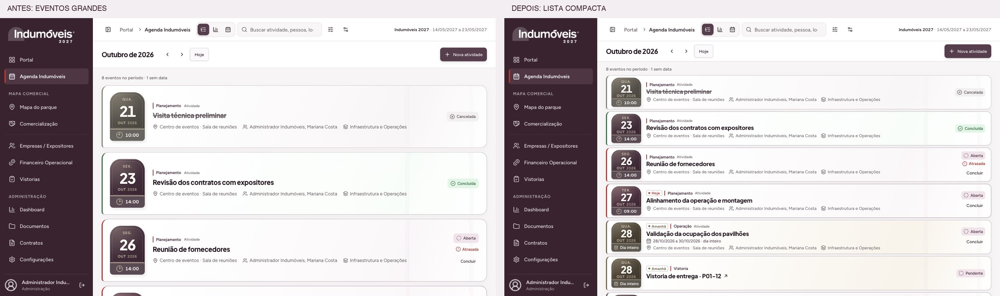

# Agenda — densidade final dos eventos

Revisão de 27/10/2026, sobre o commit `ea2a872`. A lista foi compactada conforme a referência de proporção da FenaSoja e o pedido de seis eventos completos no notebook. O tratamento arquitetônico, os horários dos ponteiros, os rótulos Hoje/Amanhã e os estados permanecem.

| Viewport CSS, zoom 100%           | Eventos completos antes | Eventos completos depois |        Altura normal depois | Primeiro / sexto evento            |
| --------------------------------- | ----------------------: | -----------------------: | --------------------------: | ---------------------------------- |
| [1366 × 768](comparison-1366.jpg) |                       3 |                    **6** |                       94 px | y=158 / término em y=752           |
| [1440 × 900](comparison-1440.jpg) |                       3 |                    **7** |                       94 px | y=158 / término em y=752           |
| [390 × 844](comparison-390.jpg)   |                       2 |                        2 | Natural, a partir de 180 px | Composição para leitura no celular |

As capturas antes/depois foram obtidas nesta rodada, com os mesmos oito registros sintéticos locais e sem rolagem inicial. [Medidas anteriores](before-measures.json) e [medidas finais](after-measures.json) incluem as coordenadas de cada evento. O Chrome foi usado para viewport exato, com `cssVisualViewport.zoom=1`; a prévia interna também permanece disponível.

A redução vem da estrutura interna: marcador de 82 × 81 px no desktop, faixa de período de 56 px, padding vertical de 5 px, espaços de 6 px entre eventos e alinhamento mais próximo entre categoria, título, intervalo e metadados. Os títulos mantêm 16 px e os metadados 12 px. O arco, a profundidade, as cores e a leitura do relógio foram preservados, sem escala por transform.

Não há altura máxima, elipse ou corte de conteúdo. Os 94 px são uma altura mínima: títulos extensos, equipes maiores e intervalos podem ampliar a linha naturalmente. No celular, o botão Concluir mantém área de toque de 44 px; as linhas acomodam as informações completas.

Validação desta rodada:

- Seis eventos completos em 1366 × 768 e sete em 1440 × 900, com zoom 100% e scroll inicial zero.
- Sem overflow horizontal nos três tamanhos.
- [Texto ampliado a 200% em 390 px](text-200-390.jpg), sem overflow; [medidas](text-200.json).
- Abertura de detalhes e Escape mantêm o evento selecionado e retornam o foco ao título.
- Build de produção, formatação e `git diff --check` aprovados. A alteração de produção desta revisão é exclusivamente CSS; os 309 testes da implementação funcional anterior permanecem documentados no relatório geral.

Não houve alteração em dados, filtros, permissões, horários, ações ou navegação. As imagens usam o harness local com componentes reais; não representam implantação em produção.
