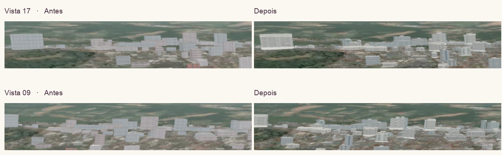
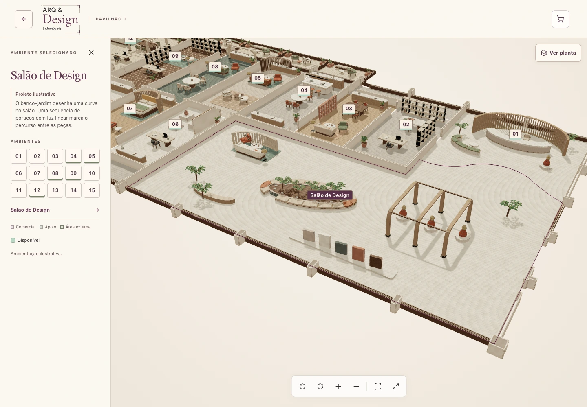

# O centro de Santa Rosa e o Pavilhão 1 vistos no mapa

## O que se vê a partir do parque

Nas três imagens de referência, o parque ocupa o primeiro plano. Além da divisa, aparecem casas e galpões baixos. As torres se concentram no setor urbano e têm poucos pixels de largura na tela. Na versão anterior, a repetição de paredes claras e coberturas planas aproximava prédios de alturas diferentes. Os bosques apareciam como volumes verdes contínuos.

Os pares abaixo usam a mesma câmera, luz natural e resolução de renderização. As posições foram ajustadas a pontos visíveis nos anexos, entre eles quinas de pavilhões e cruzamentos. O ajuste usou 65, 82 e 74 correspondências respectivamente, com erro mediano de reprojeção inferior a um pixel nas imagens em meia resolução. As capturas usam a rota real do mapa, com dados comerciais de teste.

| Anexo | Referência visual | Versão anterior | Esta versão |
| --- | --- | --- | --- |
| 02.52.09 | Arena em primeiro plano, centro à direita no horizonte | [Abrir vista anterior](09-antes.webp) | [Abrir vista atual](09-depois.webp) |
| 02.52.17 | Torres à esquerda, bosque atrás da pista e talhão junto à divisa | [Abrir vista anterior](17-antes.webp) | [Abrir vista atual](17-depois.webp) |
| 02.52.25 | Casas da avenida, núcleo urbano à esquerda e paisagem agrícola à direita | [Abrir vista anterior](25-antes.webp) | [Abrir vista atual](25-depois.webp) |



As 453 construções de altura estimada acima de 12 m, entre 1,5 e 4 km do parque, recebem oito famílias de fachada. As bases, os recuos e as coberturas variam dentro do contorno registrado. Nas 28 torres com maior presença angular, sacadas e aletas também se projetam para fora do corpo principal. Nas demais, esses detalhes se leem na textura. [Prancha das oito famílias](../santa-rosa/torres-higgsfield.webp)

Predominam concreto, cinza mineral e reboco claro. Duas famílias têm um painel estreito de vidro fumê ou verde mineral. Elas aparecem em 91 das 453 construções altas. Em cada uma das vistas 17 e 09, conferimos 35 fachadas na captura. A mediana do contraste entre as partes claras e escuras de cada fachada (percentis 90 e 10 de luminância) passou de 13,8 para 23,7 na vista 17 e de 11,2 para 22,1 na 09, em escala de 0 a 255. Nas duas vistas a mediana da diferença entre os canais de cor foi de quatro níveis. A comparação fotográfica de referência inclui edifícios de períodos e iluminação diferentes. [Estudo de cor e acabamento final](ajuste-de-cor.webp) · [Panorâmica do centro de Santa Rosa, Loco085](https://commons.wikimedia.org/wiki/File:Santa_Rosa_-_RS_-_Panor%C3%A1mica_centro.jpg)

Os recortes acima ampliam cada pixel da captura por um fator de dois. Os arquivos individuais da tabela preservam a escala da vista. No percurso em vídeo, a câmera parte da avenida e volta pelo mesmo caminho, passando pelos pavilhões, pela divisa e pela Arena. [Bairros e copas em detalhe](detalhes-entorno.webp) · [Comparar o percurso em movimento](percurso.mp4)

A posição, o contorno e a altura estimada das construções vêm das fontes geográficas do mapa. Os acabamentos, os desenhos das sacadas e os coroamentos são interpretações de arquitetura local. A galeria de obras de Santa Rosa serviu de referência para o desenho das varandas, dos vãos envidraçados e das fachadas de alvenaria. [Obras da Itamar Engenharia](https://www.itamarengenharia.com.br/galeriaDeObras.php) · [Fontes e registro geográfico](../../commercial-map-santa-rosa.md) · [Cena de fachadas no Higgsfield](https://higgsfield.ai/3d-jutsu/a82046ce-228f-43a8-91e3-6e8d2730da7b)

## Dentro da mostra ARQ & Design

A planta humanizada e a maquete vêm da mesma cena construída no Higgsfield. A recepção acompanha a curva do acesso com um balcão de pedra e um brise. No Salão de Design, um banco-jardim elíptico e três pórticos iluminados organizam o percurso. A sala de materiais, a biblioteca e a cozinha têm modos distintos de expor, trabalhar e receber. A planta documental governa as paredes, os acessos, os 15 espaços e os cinco terraços. A ambientação é uma proposta de exposição. As referências de design brasileiro contemporâneo orientaram o uso de materiais e as formas do mobiliário. [Cena editável](https://higgsfield.ai/3d-jutsu/2158e908-c2fd-4fc5-884f-f8b27fefc9d5) · [Espaços expositivos na DW!](https://dwsemanadedesign.com.br/acontece/portobello-shop-inaugura-flagship-de-4-andares-assinada-por-isay-weinfeld-na-alameda-gabriel/) · [Desenho de mobiliário brasileiro na DW!](https://dwsemanadedesign.com.br/acontece/colecao-2026-da-saccaro-estreia-na-dw-com-conceito-a-maestria-da-forma/)

| Vista | Desktop | Celular emulado |
| --- | --- | --- |
| Planta original | [Abrir](planta-1440-antes.webp) | [Abrir](planta-390-antes.webp) |
| Planta humanizada | [Abrir](planta-1440-depois.webp) | [Abrir](planta-390-depois.webp) |
| Maquete completa | [Abrir](maquete-1440.webp) | [Abrir](maquete-390.webp) |
| Ambiente 12 | [Ver o pergolado](ambiente-12-1440.webp) | [Ver em 3D](ambiente-12-390.webp) · [Terraço na planta](terraco-390.webp) |



Na planta, selecionar um espaço abre a ficha comercial. **Ver ambiente em 3D** enquadra esse lote e sua área externa. **Ajustar à tela** recupera a vista geral. Os marcadores indicam a disponibilidade também na maquete. [Recepção](ambiente-01-1440.webp) · [Ilha de cozinha do 04](ambiente-04-1440.webp) · [Cinco estados comerciais na planta](disponibilidade-1440.webp) · [Vídeo da troca de vista](planta-maquete.mp4)

A planta inicial tem 2.104 × 932 pixels e 153 KiB. Ao ampliar ou quando a densidade de tela pede, a aplicação carrega a versão de 4.208 × 1.864 pixels e 560 KiB. A maquete de 1,71 MiB tem 114.339 triângulos e materiais compartilhados e só é solicitada ao abrir o 3D. Com a câmera parada, o renderizador aguarda interação. O ensaio incluiu falha no download do GLB e perda do contexto WebGL. Em ambos, a planta continuou utilizável com o lote selecionado. [Manifesto dos ativos e instruções de exportação](../../../scripts/pavilion-interior/arq-design/manifest.json)

## Medição e reprodução

O ensaio comparou o build de produção de `f9c9c8f` com o desta PR em Chrome local, Apple M5, 16 GiB de memória e GPU Metal. O perfil detalhado usou um buffer de 1.464 × 897 e o leve, de 390 × 689. Os tempos abaixo são observações desse percurso com inventário simulado e servidor local. Os perfis móveis foram emulados no mesmo computador.

| Perfil e cache | Primeiro quadro útil (s) | Paisagem pronta (s) | Transferência total (MB) | Intervalo entre quadros, p95 (ms) |
| --- | --- | --- | --- | --- |
| Detalhado · frio | 1,01 → 1,44 | 2,76 → 5,19 | 4,92 → 5,49 | 16,8 → 16,8 |
| Detalhado · quente | 0,80 → 0,90 | 2,38 → 3,60 | 0,02 → 0,02 | 16,7 → 16,8 |
| Leve · frio | 0,88 → 1,39 | 1,42 → 3,73 | 2,51 → 2,70 | 16,8 → 16,8 |
| Leve · quente | 0,80 → 1,13 | 1,45 → 2,23 | 0,02 → 0,02 | 16,7 → 16,7 |

Cada célula apresenta **antes → depois**. Em cache quente, o navegador transferiu 0 bytes de arquivos da paisagem em ambos os perfis. O ensaio com pressão no renderizador verificou a estabilidade do nível de detalhe durante a órbita. As estimativas de memória, o buffer efetivo, o retorno ao norte e os tempos de cada passagem estão no relatório. [Medições completas](medicoes.json)

Na maquete do Pavilhão 1, foram medidos 119 intervalos no desktop e 118 no celular emulado. O p95 foi de 16,7 ms e 16,7 ms respectivamente. Do clique em **Maquete 3D** ao primeiro quadro com o modelo, a aplicação levou 233 ms no desktop e 225 ms no celular emulado. O roteiro comercial também conferiu preço fixo, seleção, carrinho e checkout.

Para repetir a validação, gere dois builds de produção, um por versão, e sirva cada saída com o adaptador local. Use a mesma porta em momentos distintos ou ajuste `MAP_BASE_URL` e os diretórios de saída.

```sh
npm run build
MAP_HTTP_CACHE=1 node scripts/serve-commercial-map-build.mjs 4174
```

Em um segundo terminal, execute os ensaios no build servido. Para guardar a base, use a fase `before` e outro diretório de saída.

```sh
export MAP_BASE_URL=http://127.0.0.1:4174
for task in reference-views journey visual pressure; do
  MAP_LANDSCAPE_PHASE=after MAP_LANDSCAPE_TASK="$task" \
    MAP_ARTIFACT_DIR="artifacts.local/validacao/$task" node scripts/commercial-map-landscape-validation.mjs
done
PAVILION_1_GALLERY_PHASE=after MAP_ARTIFACT_DIR=artifacts.local/validacao/p1 \
  node scripts/pavilion-1-pricing-validation.mjs
MAP_ARTIFACT_DIR=artifacts.local/validacao/comercial node scripts/pavilion-1-pricing-validation.mjs
```
