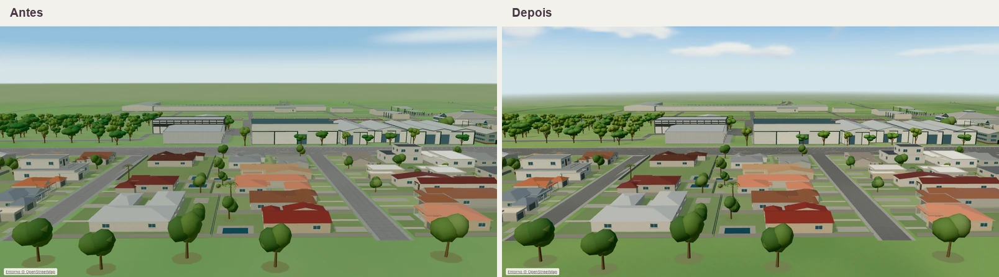

# Luz, materiais e atmosfera do mapa comercial

## Referência e inspeção

Em 13 de novembro de 2026, a `main` local e a remota apontavam para `d823bb43da9a54225911d98578d3f60a0ce08dbc`. No [mapa publicado](https://indumoveisapp.com/mapa), foram verificadas a vista 3D de abertura em Automático, a superior em Leve, a oblíqua em Equilibrado e uma aproximação em Detalhado. O publicado carregou `MapRenderer-CKfvn1e4.js`, enquanto o build local limpo produziu `MapRenderer-Dy4Cu3bI.js`. Os dois exibiram os mesmos controles e o mesmo comportamento visual de referência. O hash do commit implantado não foi exposto e os arquivos compilados não eram idênticos. A comparação controlada usa dois builds locais, com a `main` confirmada como base.

| Vista e perfil                           | O que se observa nos mesmos enquadramentos                                                                                          | Par                                                    |
| ---------------------------------------- | ----------------------------------------------------------------------------------------------------------------------------------- | ------------------------------------------------------ |
| Geral · Automático                       | A grama da abertura ganha variação entre áreas abertas e arborizadas. Telhados claros, vias e lotes continuam distinguíveis.        | [Geral](desktop-auto-geral.webp)                       |
| Superior · Leve                          | O desenho das vias se destaca e a variação da grama cruza os limites comerciais.                                                    | [Superior](desktop-light-superior.webp)                |
| Oblíqua · Equilibrado                    | Os pavilhões e o bairro ganham separação entre superfícies. O terreno perde detalhe gradualmente no fundo.                          | [Oblíqua](desktop-balanced-obliqua.webp)               |
| Fachadas · Detalhado                     | Coberturas claras mantêm leitura dos planos e as copas junto aos pavilhões ganham profundidade.                                     | [Pavilhões](desktop-detailed-pavilhoes.webp)           |
| Administrativo · Equilibrado             | Granulação fina no asfalto, reflexo moderado nas faixas de vidro e contraste entre fachada protegida e cobertura iluminada.         | [Administrativo](desktop-balanced-administrativo.webp) |
| Eventos · Detalhado                      | Inclinações e nervuras do telhado se mantêm legíveis. As colunas e a base mineral ganham separação.                                 | [Centro de eventos](desktop-detailed-eventos.webp)     |
| Horizonte · Leve                         | O corte verde contra o céu dá lugar à transição atmosférica. As nuvens aparecem em diferentes alturas, separadas por áreas abertas. | [Horizonte](desktop-light-horizonte.webp)              |
| Lotes · Automático                       | O campo contínuo de grama preserva o contraste dos números e limites.                                                               | [Lotes](desktop-auto-lotes.webp)                       |
| Pavilhões · Automático em viewport móvel | O contraste de materiais e o volume das copas também aparecem no enquadramento estreito.                                            | [Viewport móvel](mobile-auto-pavilhoes.webp)           |



As imagens pareadas usam o mesmo tamanho de buffer, posição, alvo e perfil efetivo. Os pares desktop foram redimensionados proporcionalmente para 800 px por quadro. O par móvel mantém o tamanho nativo. Câmeras e amostras estão em [medições](medicoes.json).

## Calibração

- **Cor e luz.** Three.js 0.186.1 trabalha em RGB linear. Cores hexadecimais e albedos sRGB são interpretados uma vez, cores de vértices são gravadas em linear e normal, rugosidade e oclusão são dados. Os shaders de céu e terreno passam pela mesma conversão final para sRGB. O terreno interpola a névoa em luz linear antes do tone mapping. A combinação entre albedo, material e vértices foi recalibrada para reduzir o escurecimento do atlas e as mudanças tardias. Rótulos e sobreposições comerciais têm cor independente da exposição da cena.
- **Exposição.** A base usava `NeutralToneMapping`, exposição `1`, sol `2,65`, hemisférica `1,18` e preenchimento `0,32`. O sol continua fixo a 45°, agora levemente mais quente, com intensidade `3,12`, hemisférica fria `0,94`, preenchimento `0,19` e exposição `1,04`. O preenchimento mais baixo aumenta a leitura dos planos e deixa as faces protegidas visíveis. A comparação em CPU das curvas Neutral, ACES e AgX da versão instalada, aplicada a amostras lineares estimadas das capturas, mostrou que ACES clareava mais o asfalto e que AgX reduzia a diferença cromática entre grama e céu. Mantivemos Neutral. A comparação das curvas não equivale a renderizar toda a cena com os três operadores.
- **Materiais.** Grama usa um campo contínuo em coordenadas do mundo, com variações amplas e locais e microtextura filtrada. O asfalto seco ganhou granulação irregular. Concreto e pintura mantêm resposta fosca, tijolos têm juntas discretas, e chapa pintada, metal exposto e vidro usam rugosidade e reflexos próprios. No recorte do telhado do centro de eventos, o maior canal RGB foi 193 de 255. Nas nuvens amostradas, 236 de 255.
- **Vegetação e sombras.** As copas do parque usam cores de interior e pontas e normais de copa, com iluminação difusa e sem emissivo constante. A sombra instanciada combina projeção solar da copa e contato do tronco. Leve e Equilibrado usam um lote de geometrias de sombra sem sobreposição interna para os pavilhões. Detalhado substitui essa projeção pelo mapa estático de 1024². O enquadramento do mapa de sombra cobre cerca de 57% menos área e exclui detalhes que dependem da câmera. As estruturas permanentes e árvores mantêm projeções econômicas próprias. O entorno residencial conserva copas mais esquemáticas. As sombras econômicas têm bordas mais definidas.
- **Céu e distância.** O primeiro quadro usa um gradiente simples. O panorama estático de 45.053 bytes é carregado depois e, quando visível, faz uma transição curta, respeitando movimento reduzido. O ambiente filtrado deriva do mesmo panorama e é preparado uma vez por instância WebGL. O horizonte faz a transição principalmente fora da área comercial. Na faixa amostrada da vista do horizonte, a maior mudança entre linhas adjacentes caiu de 47,0 para 9,5 níveis RGB.

## Medição no navegador

Chrome 157.0.8103.51 em macOS 26.6, Apple M5 com 16 GiB e WebGL 2 via ANGLE Metal. Viewports de **1366×768** e **390×844**, DPR 1 e movimento reduzido. Dois contextos novos por combinação de viewport e perfil em cada build. A autenticação e o inventário foram simulados localmente pela infraestrutura de teste. O roteamento desativa o cache HTTP. Em cada caso, o percurso percorreu 6,5 s de órbita, aproximação e deslocamento com a mesma câmera inicial. O viewport móvel executou no mesmo Mac, com emulação de tela e entrada tátil. Não havia celular intermediário físico disponível para confirmar a meta de 30 FPS.

| Viewport      | Perfil                   | Navegação 2D disponível (s) | Primeiro 3D útil (s) | Acabamento (s) | Quadro mediano/p95 (ms) |
| ------------- | ------------------------ | --------------------------: | -------------------: | -------------: | ----------------------: |
| Desktop       | Automático → Equilibrado |                 2,69 → 0,66 |          4,58 → 0,95 |   10,10 → 2,31 |   16,7/16,8 → 16,7/16,8 |
| Desktop       | Leve                     |                 2,37 → 0,62 |          2,96 → 0,83 |    6,36 → 2,14 |   16,7/16,8 → 16,7/16,8 |
| Desktop       | Equilibrado              |                 1,57 → 0,62 |          2,17 → 0,83 |    5,73 → 2,14 |   16,7/16,8 → 16,7/16,7 |
| Desktop       | Detalhado                |                 1,62 → 0,62 |          3,34 → 1,13 |    8,01 → 2,76 |   16,7/16,8 → 16,7/16,8 |
| Móvel emulado | Automático → Equilibrado |                 3,64 → 0,62 |          4,41 → 0,85 |    7,66 → 2,18 |   16,7/16,8 → 16,7/16,8 |
| Móvel emulado | Leve                     |                 3,71 → 0,62 |          4,69 → 0,85 |    8,22 → 2,17 |   16,7/16,8 → 16,7/16,7 |
| Móvel emulado | Equilibrado              |                 1,15 → 0,63 |          1,80 → 0,87 |    5,01 → 2,19 |   16,7/16,8 → 16,7/16,7 |
| Móvel emulado | Detalhado                |                 1,33 → 0,62 |          1,98 → 0,85 |    5,74 → 2,16 |   16,7/16,8 → 16,7/16,8 |

Os tempos de abertura são a mediana de duas amostras. A última coluna mostra o pior p50 e o pior p95 das duas passagens. O primeiro quadro 3D corresponde à publicação da representação 3D navegável. O acabamento inclui o contexto do entorno, atlas, terreno, céu e reflexos. A rodada inicial da base teve alta variação de abertura. Na repetição em Automático com o host já aquecido, a abertura ficou praticamente estável. No desktop, a navegação 2D ficou em 0,639 → 0,643 s, o primeiro 3D em 0,861 → 0,864 s e o acabamento em 2,165 → 2,169 s. No viewport móvel, 0,611 → 0,627 s, 0,833 → 0,849 s e 2,136 → 2,153 s, respectivamente.

- **Quadros e travamentos.** Cerca de 60 quadros/s no host testado. Na primeira rodada, os maiores intervalos observados durante o percurso foram 100,1 → 33,4 ms. Houve tarefas tardias na thread principal, com o maior registro após o 3D útil de 1.312 → 436 ms na rodada inicial e 360 → 354 ms na repetição com host aquecido. Tarefas longas podem afetar a resposta quando coincidem com entrada. Os intervalos são entre quadros ativos agendados e o tempo de submissão é de CPU. O teste não coletou temporizações da GPU.
- **Chamadas de desenho.** Na vista inicial, Automático, Leve e Equilibrado ficaram em 155 no desktop e 156 no viewport móvel. Detalhado ficou em 154 e 155, respectivamente. No percurso desktop, o pico foi de 154 nas qualidades econômicas e 153 no Detalhado. Em Detalhado, a contagem de atualizações da sombra ficou em uma antes e depois do percurso.
- **Texturas e resolução.** Na vista inicial dos perfis econômicos foram 12 → 11 texturas WebGL e 11,38 → 9,88 MiB estimados. Em Detalhado foram 14 → 14 e 20,88 → 19,38 MiB estimados. A estimativa soma alocações conhecidas e mipmaps aplicáveis. O contador WebGL registra texturas residentes no momento da captura. O buffer permaneceu em 1294×655 no desktop e 390×689 no viewport móvel, com escala adaptativa 1.
- **Reabertura.** Três saídas e retornos via navegação da aplicação no desktop Automático. Em cada saída havia zero contextos ativos e cada retorno usou um. Na entrega os três retornos ficaram em 11 texturas, 117 geometrias e 9,88 MiB estimados. Isso valida o ciclo do contexto e o patamar de recursos do renderer nessas reaberturas.
- **Falhas opcionais.** No build final, bloquear o PNG manteve o gradiente simples e os reflexos filtrados. Forçar falha do filtro manteve o panorama rico e a iluminação direta. Em ambos os testes, o acabamento concluiu e o zoom funcionou sem erros de página ou shader.
- **Renderização por software.** A abertura em Automático com SwiftShader e viewport móvel chegou ao acabamento sem erros de shader, usando Leve e o buffer adaptativo de 195×344. Essa verificação de compatibilidade não entra na medição de quadros com GPU.

## Reprodução

A partir de cada revisão, rode `vite build` e inicie o adaptador local em portas distintas. O script grava os PNGs originais e os dados por passagem em `artifacts.local/map-daylight`.

```sh
node scripts/serve-commercial-map-build.mjs 4190 /caminho/build-base
MAP_BASE_URL=http://127.0.0.1:4190 MAP_DAYLIGHT_PHASE=before node scripts/commercial-map-daylight-validation.mjs

node scripts/serve-commercial-map-build.mjs 4208 /caminho/build-candidato
MAP_BASE_URL=http://127.0.0.1:4208 MAP_DAYLIGHT_PHASE=after node scripts/commercial-map-daylight-validation.mjs
```

A validação de código inclui build de produção, TypeScript, lint dos arquivos TypeScript alterados e 626 testes. A comparação visual não requer acesso aos dados de produção.
