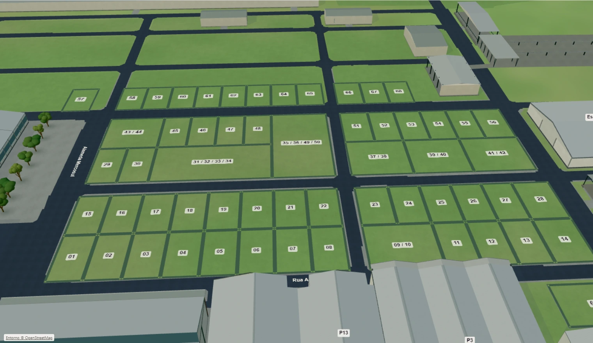
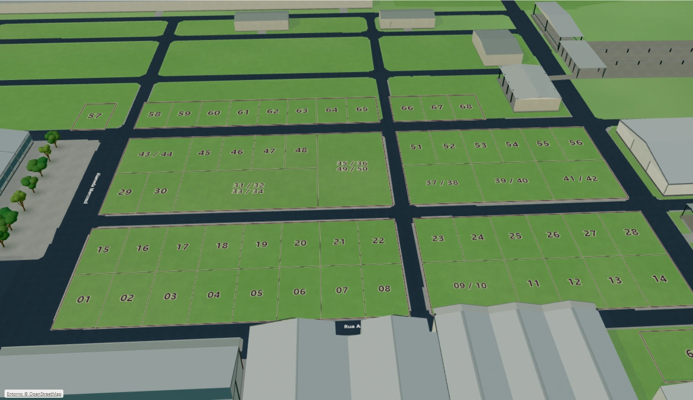
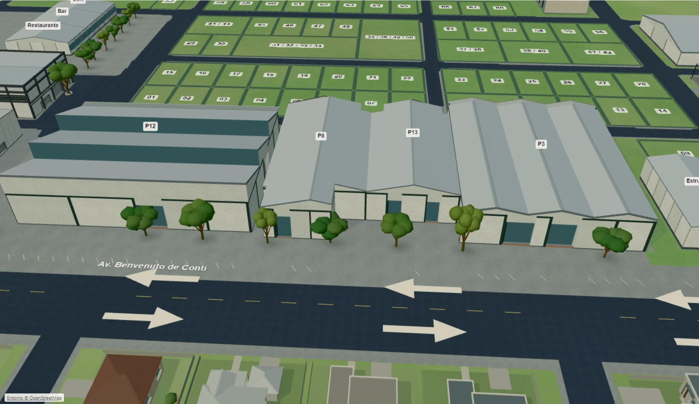
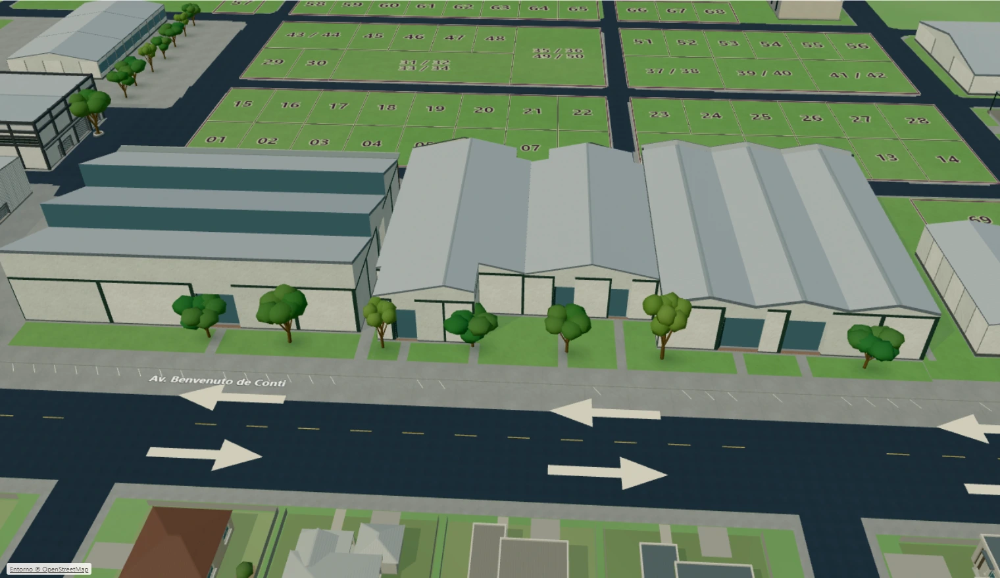

# Evidências — mapa comercial, 03/11/2026

Implementação e causas estão no [relatório da revisão](../../commercial-map-refinement-2026-11-03.md). A base é o merge `980d1dc` da PR 12. Os arquivos [comparison.json](comparison.json), [before.json.gz](before.json.gz), [after.json.gz](after.json.gz) e [commercial-protection.json](commercial-protection.json) permitem auditar câmera, recursos e integridade.

As imagens vêm do canvas real do build de produção local, com câmera conferida e perfil Leve. Viewport 1600 × 1000, canvas CSS 1520 × 880, buffer 1314 × 760, DPR efetivo 0,8646, Chromium 153, Windows e Intel UHD/i5-1035G1. Os PNGs originais são identificados por SHA-256 no manifesto. A conversão para WebP qualidade 92 não redimensiona, recorta ou retoca a cena. São nove pares: oito do canvas e um da abertura completa com controles.

## Comparação visual

| Enquadramento                    | Antes                                  | Depois                                 |
| -------------------------------- | -------------------------------------- | -------------------------------------- |
| Abertura com controles e bosque  | [Antes](before/startup-workspace.webp) | [Depois](after/startup-workspace.webp) |
| Visão geral comercial            | [Antes](before/overview.webp)          | [Depois](after/overview.webp)          |
| Parque completo superior         | [Antes](before/superior.webp)          | [Depois](after/superior.webp)          |
| Lotes em vista oblíqua           | [Antes](before/lots.webp)              | [Depois](after/lots.webp)              |
| Aproximação dos números          | [Antes](before/lots-close.webp)        | [Depois](after/lots-close.webp)        |
| Fundos de P1                     | [Antes](before/p1-rear.webp)           | [Depois](after/p1-rear.webp)           |
| Fundos de P14                    | [Antes](before/p14-rear.webp)          | [Depois](after/p14-rear.webp)          |
| Fundos e sequência até a avenida | [Antes](before/avenue-rear.webp)       | [Depois](after/avenue-rear.webp)       |
| Fachada P3 preservada            | [Antes](before/p3-front.webp)          | [Depois](after/p3-front.webp)          |

Lotes antes:

Lotes depois:

Fundos e avenida antes:

Fundos e avenida depois:

## Medições e testes

**454 testes em 74 arquivos**, TypeScript, build de produção e ESLint dos arquivos alterados aprovados. O lint amplo da feature encontrou 5.312 diferenças de CRLF em arquivos não alterados; não foi feita uma limpeza de formatação fora do escopo. Um teste antigo de identidade de texturas foi corrigido para comparar identidade diretamente, evitando a comparação profunda de megabytes pelo mecanismo de diagnóstico do Vitest, sem aumentar seu timeout.

O [registro de navegação](navigation.json.gz) contém **17 cenários aprovados**, zero erros de aplicação/shader e quinze mensagens de fontes bloqueadas/404 do laboratório. Inclui toque CDP nativo no interior do lote, além de pinça/giro, nas duas orientações. [Lote selecionado no celular](interaction/touch-selected-lot01-390x844.webp) e [pavilhão selecionado no desktop](interaction/desktop-selected-pavilion12.webp) mostram a numeração sem placa e as informações acessíveis pela seleção. No ensaio Superior com P12 selecionado, o footprint ocupa 586 dos 950 pixels livres (61,7%), deixando avenida, verde e vizinhos no enquadramento.

| Medida no mesmo percurso de órbita              |       Base PR 12 |          Revisão |
| ----------------------------------------------- | ---------------: | ---------------: |
| Quadros ativos amostrados, aproximadamente 15 s |              912 |              931 |
| Intervalo mediano / p95                         |   16,7 / 16,7 ms |   16,7 / 16,7 ms |
| Quadros acima de 200 ms                         |                0 |                0 |
| p95 de submissão de desenho em CPU              |           2,4 ms |           1,7 ms |
| Draws / triângulos na pose final equivalente    |    142 / 233.137 |    143 / 234.771 |
| Geometrias / texturas                           |         127 / 14 |         129 / 13 |
| Memória de textura estimada                     | 12.495.645 bytes | 11.927.665 bytes |

As três repetições do mesmo percurso de LOD mantiveram os recursos constantes e um contexto ativo em cada versão. Não houve perda de contexto ou erro de aplicação/shader. São observações locais, sem inferência de ganho estatístico no tempo de CPU.

Com o mesmo delta de roda de 100 pixels CSS, a distância final passa a variar por fatores **0,7261 / 1,3771** (aproximar/afastar), contra **0,8607 / 1,1618** na base. A proporção é igual na escala de um lote e na do parque. O relatório também guarda leituras após uma espera nominal de 32 ms; incluem o agendamento do Playwright e não medem latência física. O teste de navegação complementa isso com despacho dentro do navegador, fluxo de 20 eventos pequenos, inversões rápidas e verificação da ausência de deriva posterior.

Na captura de abertura ampla e oblíqua, 37 números cabem com o limiar de leitura. No enquadramento geral comercial, 58 aparecem sem colisões. Os demais passam a aparecer conforme a aproximação; não exigem selecionar o lote. Os 59 envelopes e 70 números permanecem no cadastro e na busca. **172/172 pontos internos**, afastados das linhas e dos números, acertaram a superfície de seleção esperada. O fallback independente foi exercitado sem WebGL em 320 × 740, com busca, seleção e fechamento por teclado e cabeçalho sem overflow.

O laboratório registrou cinco mensagens de console na base e dez na revisão, esta incluindo também o fallback: fontes externas bloqueadas e respostas de recurso 404, separadas de erros de aplicação. Elas permanecem nos relatórios e não são apresentadas como console inteiramente limpo.

O estudo usa eventos reais do navegador, dados interceptados exclusivamente no laboratório e zero gravações comerciais. Os testes de navegação registram roda em três modos de delta, fluxo de trackpad sintético, inversões rápidas, interseções junto ao horizonte, giros/deslocamentos com ajuda fechada, interrupções de foco, seleção repetida, saída do cursor e retorno A → B → fechar. O toque é emulado nos tamanhos 390 × 844 e 844 × 390; não é evidência de aparelho físico.

Os testes de geometria verificam a assinatura comercial, arestas compartilhadas, pontos internos côncavos, recortes sem sobreposição, remoção do concreto na origem e continuidade dos acessos/passeio. Tempos de quadro são intervalos de frames ativos submetidos, e não tempo de GPU ou latência física. Aberturas pontuais não demonstram ganho estatístico.

## Limites

Larguras e posições de paisagismo são estimativas em unidades do desenho. As fachadas e a implantação da PR 12 foram preservadas; esta revisão não acrescenta comprovação de medidas, faces ocultas ou acessibilidade normativa. Mouse e roda foram automatizados no host; trackpad e toque são simulados. Android, iPhone/Safari e trackpad físicos não foram testados. Não houve publicação em produção nesta entrega.
