# Pavilhões fotografados — evidência no mapa completo

Base: `a10053b11e985a663fd547d4ce84f3b5e77ea34f`, branch `codex/parque-registro-territorial`. As imagens seguintes são capturas reais do build de produção local, com o parque e o renderer existentes. São **30 pares dos pavilhões** (frente, oblíqua, superior, próxima e reversa de cada um) e **8 pares do parque completo**, com câmeras repetidas e conferidas numericamente. As fotografias fornecidas são inventariadas [aqui](../../commercial-map-pavilion-photos-2026-11.md).

| Pavilhão     | Base anterior à reconstrução fotográfica | Resultado                           |
| ------------ | ---------------------------------------- | ----------------------------------- |
| P3 e Brigada | 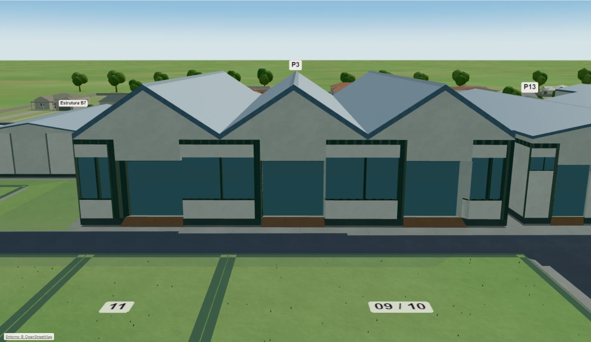        | 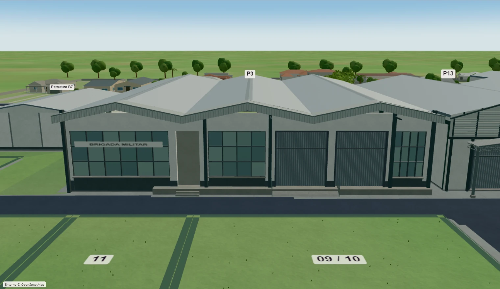   |
| P13          | 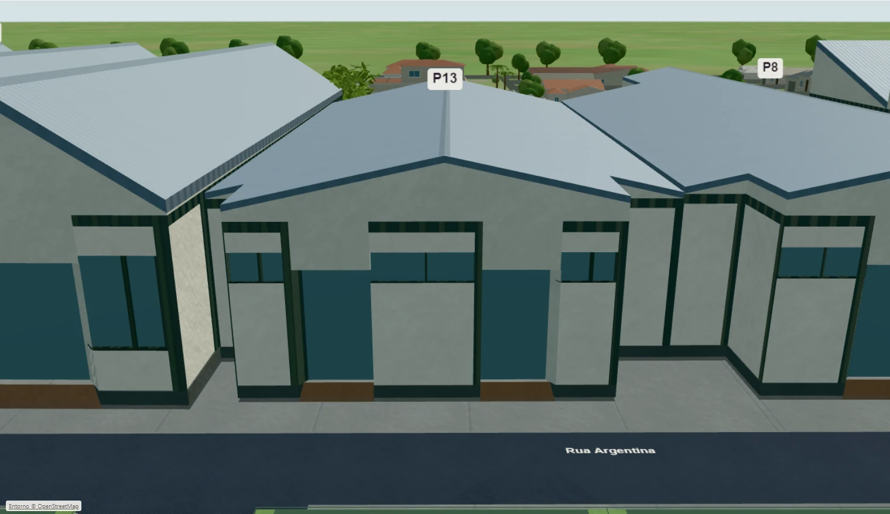      | 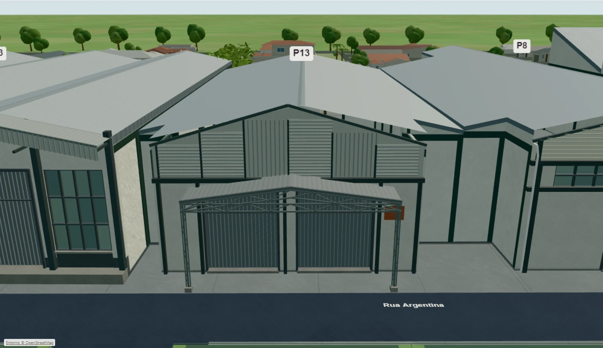 |
| P8           | 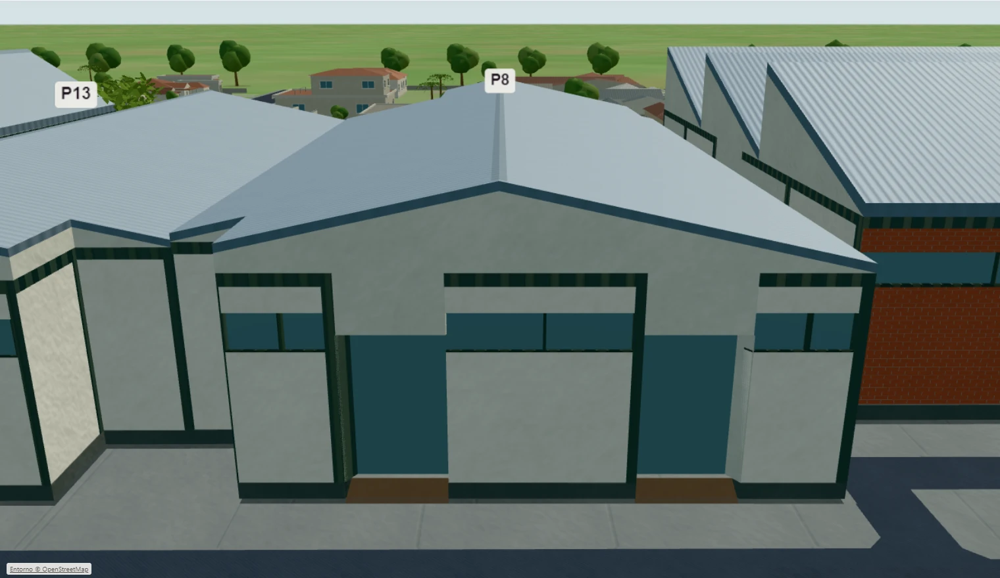        | 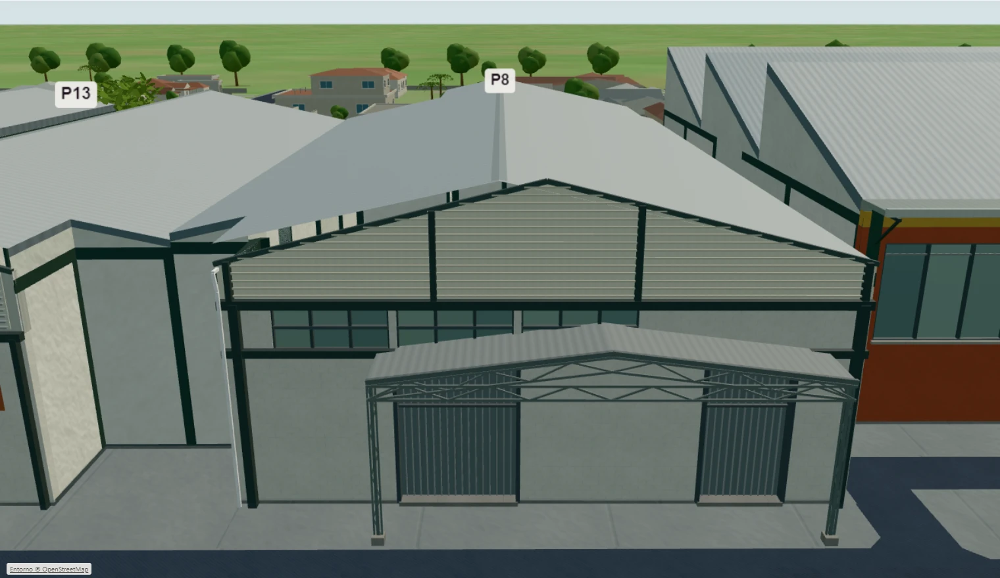   |
| P12          | 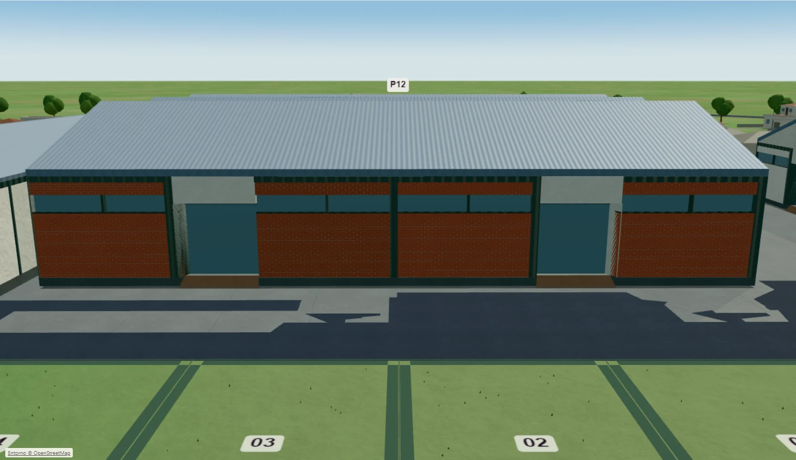      | 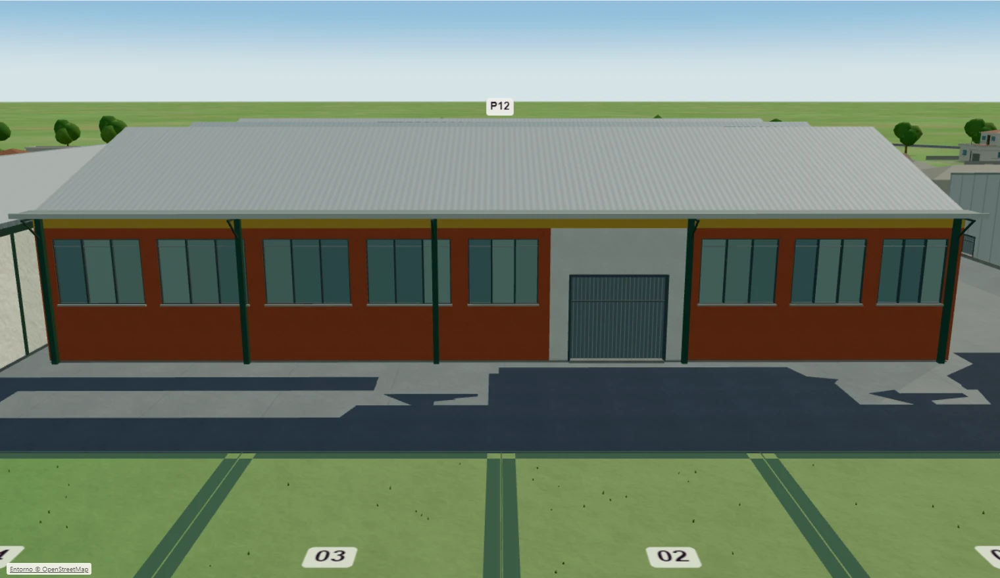 |
| P14          | 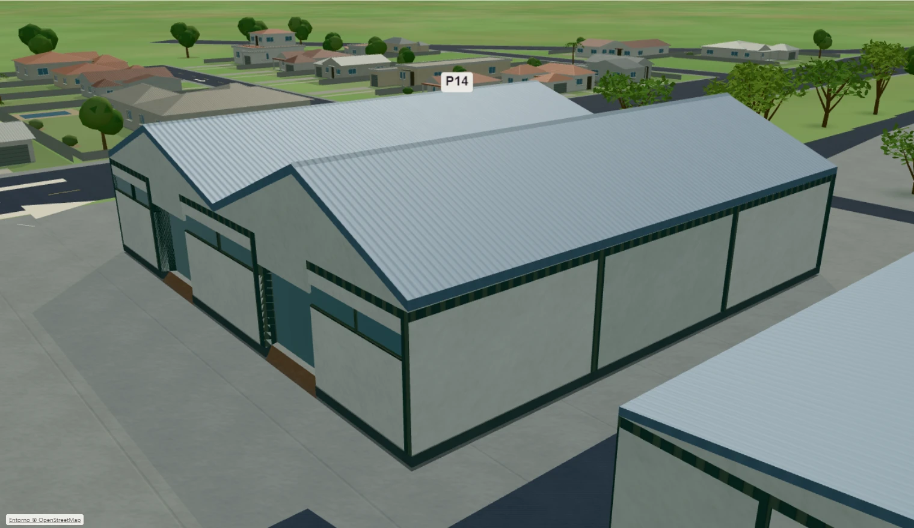      | 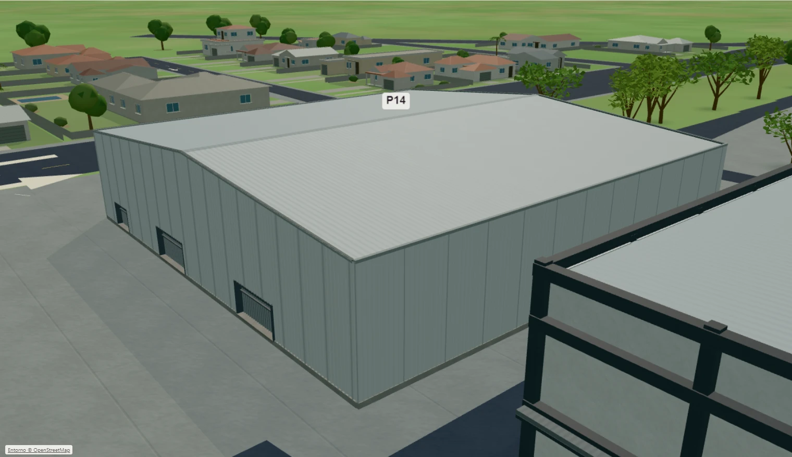 |
| P1           | 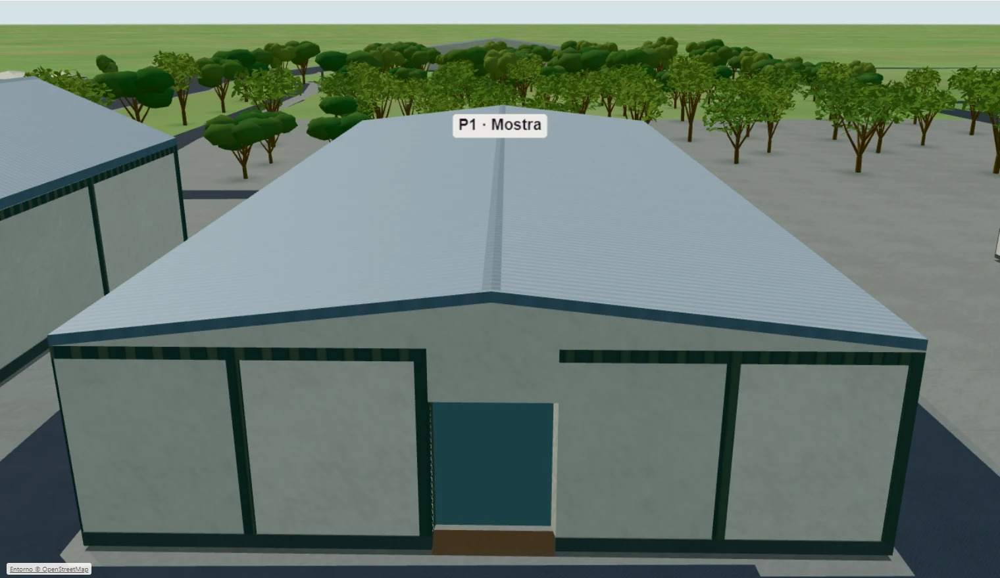        | 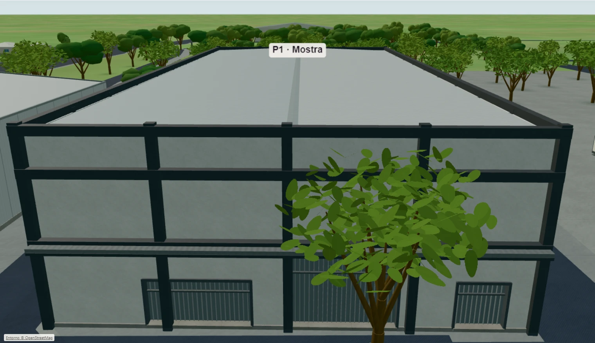   |

As poses de P14 usam aproximação frontal oblíqua pelo corredor existente, evitando a oclusão causada por P12; nenhum edifício foi escondido para a captura. A câmera mantém os limites de segurança do produto. Não há câmera de caminhada ou certificação de inspeção à altura dos olhos.

| Construção | Oblíqua                       | Superior                       | Próxima                     | Reversa                    |
| ---------- | ----------------------------- | ------------------------------ | --------------------------- | -------------------------- |
| P3         | [ver](after/p3-oblique.webp)  | [ver](after/p3-superior.webp)  | [ver](after/p3-close.webp)  | [ver](after/p3-rear.webp)  |
| P13        | [ver](after/p13-oblique.webp) | [ver](after/p13-superior.webp) | [ver](after/p13-close.webp) | [ver](after/p13-rear.webp) |
| P8         | [ver](after/p8-oblique.webp)  | [ver](after/p8-superior.webp)  | [ver](after/p8-close.webp)  | [ver](after/p8-rear.webp)  |
| P12        | [ver](after/p12-oblique.webp) | [ver](after/p12-superior.webp) | [ver](after/p12-close.webp) | [ver](after/p12-rear.webp) |
| P14        | [ver](after/p14-oblique.webp) | [ver](after/p14-superior.webp) | [ver](after/p14-close.webp) | [ver](after/p14-rear.webp) |
| P1         | [ver](after/p1-oblique.webp)  | [ver](after/p1-superior.webp)  | [ver](after/p1-close.webp)  | [ver](after/p1-rear.webp)  |

Os correspondentes anteriores estão em `before/`, com os mesmos nomes. Os PNGs foram codificados em WebP qualidade 90, mantendo 1520 × 880 pixels, sem recorte, retoque, remoção de objetos ou geração de imagem. [comparison.json](comparison.json) contém poses, erros de pareamento e SHA-256 de cada PNG e WebP.

| Parque completo  | Antes                                                                 | Depois                                                              |
| ---------------- | --------------------------------------------------------------------- | ------------------------------------------------------------------- |
| Superior         | 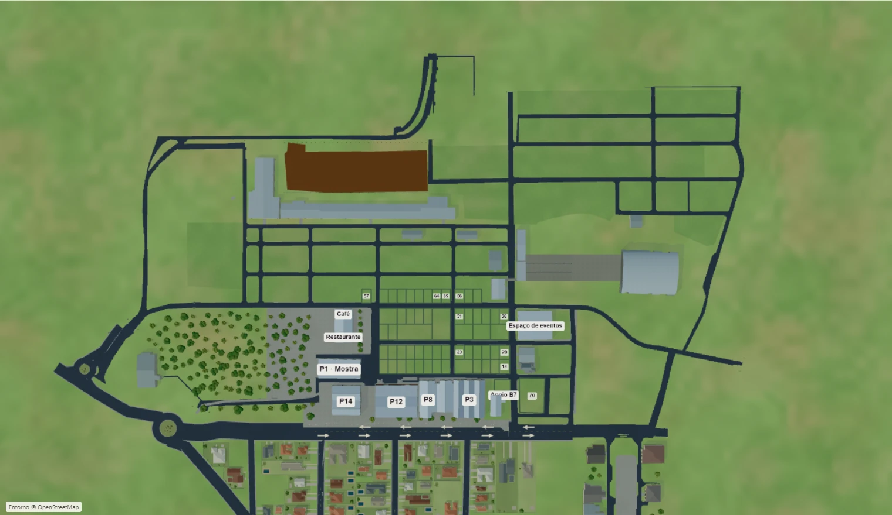                            | 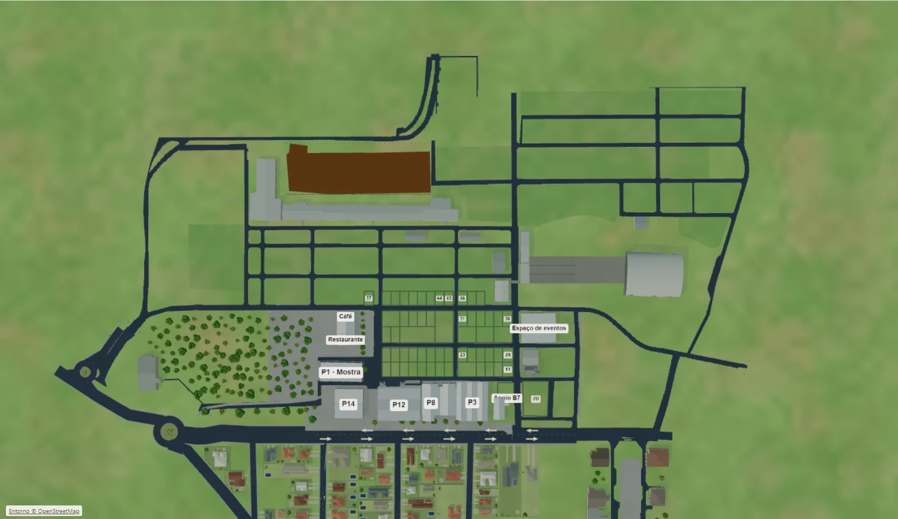                          |
| Oblíqua          | [ver](before/park-oblique.webp)                                       | [ver](after/park-oblique.webp)                                      |
| Núcleo           | [ver](before/park-commercial.webp)                                    | [ver](after/park-commercial.webp)                                   |
| Frente / reversa | [frente](before/park-front.webp), [reversa](before/park-reverse.webp) | [frente](after/park-front.webp), [reversa](after/park-reverse.webp) |
| Rural / Arena    | [rural](before/park-rural.webp), [Arena](before/park-arena.webp)      | [rural](after/park-rural.webp), [Arena](after/park-arena.webp)      |

## Medição comparável

Mesmo Windows 10.0.26200, Intel i5-1035G1, 8 GiB, Intel UHD / ANGLE D3D11, Chromium 153.0.8010.12. Viewport 1600 × 1000; canvas CSS fixo 1520 × 880; perfil Leve, DPR efetivo 0,864643, buffer 1314 × 760, resolução adaptativa 1. Câmera inicial do percurso `[110,142,186]`, alvo `[106,43]`, mesmos gestos de órbita por aproximadamente 16 s, parque completo preparado. Dados locais interceptados, sem login ou escrita em produção. A abertura usa a inicialização automática existente, antes da seleção explícita do perfil Leve.

| Medida                                                                 |   Base `a10053b` |        Resultado |
| ---------------------------------------------------------------------- | ---------------: | ---------------: |
| Quadros amostrados                                                     |              751 |              753 |
| Mediana / p95                                                          |   16,7 / 16,7 ms |   16,7 / 16,8 ms |
| Quadros acima de 200 ms                                                |                0 |                0 |
| Draw calls no fim do percurso                                          |              135 |              142 |
| Triângulos submetidos                                                  |          222.971 |          233.137 |
| Geometrias / texturas residentes nessa pose                            |         116 / 12 |         124 / 13 |
| Programas WebGL                                                        |               29 |               31 |
| Bytes estimados de texturas, incluindo mips                            |       12.320.882 |       12.495.645 |
| Heap JS usado, aproximação do navegador                                |          37,3 MB |          42,1 MB |
| Abertura útil / primeiro 3D                                            | 2.709 / 3.148 ms | 1.991 / 2.948 ms |
| Preparação dos programas essenciais, tempo de parede de `compileAsync` |         418,7 ms |         416,4 ms |
| Perdas de contexto / erros da aplicação ou shaders                     |            0 / 0 |            0 / 0 |

O custo adicional entrega fachadas, treliças, esquadrias, acessos, canteiro e identificação permanente visíveis. A textura adicional é a placa textual local da Brigada; os materiais reutilizam o atlas existente. A preparação essencial não mede exclusivamente o tempo GPU do compilador. As aberturas são observações pontuais, sujeitas a variação do sistema, sem evidência estatística de aceleração.

Três reaberturas pela navegação do aplicativo, aquecendo as mesmas poses, mantiveram **114 geometrias / 12 texturas / 12.495.645 bytes** em cada ciclo, com **um contexto WebGL ativo**. A base manteve 107 / 11 / 12.320.882. Os números após aquecimento diferem dos da pose anterior porque o driver sobe os buffers efetivamente visíveis. Não houve crescimento entre ciclos equivalentes.

`performance.memory` é uma aproximação do heap JS; não mede VRAM ou memória total do processo. Memória GPU total não é exposta pela API WebGL utilizada. O resultado de aproximadamente 60 FPS é deste equipamento/perfil; não certifica celular, trackpad físico, Safari ou hardware não testado.

## Validação e reprodução

[checks.json](checks.json) registra os comandos finais. A [prova comercial](commercial-protection.json) conserva os 59 envelopes e 70 números, com a mesma assinatura comercial da base. A [auditoria territorial atual](../park-registration-2026-11-02/park-correspondence.md) confirma 73/73 percursos e a exclusão do canteiro da rede e dos pisos. A [validação de navegação](../commercial-map-navigation/navigation-production.json) repete nove casos desktop/toque emulado, incluindo A → B → fechar, interrupção manual, seleção, roda única e retorno exato.

Para reproduzir, prepare builds separados da base e desta branch, execute `scripts/serve-commercial-map-build.mjs` em portas diferentes e use `scripts/commercial-map-realism-validation.mjs` com `MAP_PAVILION_PHOTOS_ONLY=1`, depois `MAP_PARK_REGISTRATION_ONLY=1`. Configure `MAP_BASE_URL`, `MAP_REALISM_PHASE` e `MAP_ARTIFACT_DIR` para cada versão. Por fim, `node scripts/commercial-map-pavilion-artifacts.mjs` verifica os pares e empacota a evidência; `scripts/commercial-map-navigation-validation.mjs` repete os gestos no build final. Nenhum desses laboratórios grava dados comerciais.

As medidas de altura, espessura, elementos parcialmente ocultos, fundos e níveis de rampas permanecem aproximações gráficas documentadas. As fotos não estabelecem levantamento topográfico, fotogrametria, acessibilidade normativa ou fidelidade integral das faces não registradas.
