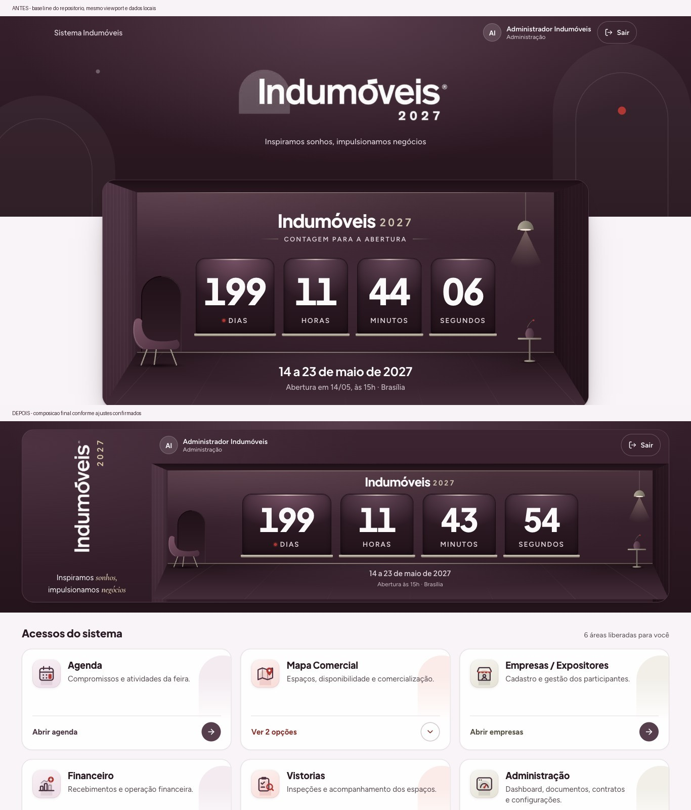

# Portal Indumóveis — composição integrada

Validação em 27/10/2026. As decisões finais incluem os ajustes solicitados durante a revisão: logo lida de baixo para cima, letreiro sem arco esbranquiçado, ano dourado, conta acima do contador, ausência do subtítulo redundante e frase institucional com tratamento tipográfico editorial.

## Evidência visual

As capturas usam os componentes reais do repositório, com dados locais de validação (edição e perfil administrador com os seis acessos). O baseline foi extraído de `597b459`; não é uma imagem aproximada. A página auxiliar de validação permanece em `artifacts.local/`, ignorada pelo Git, sem rota pública ou desvio de autenticação no produto.

| Viewport CSS, zoom 100% | Topo completo | Cards (largura × altura) | Colunas | Overflow horizontal |
| --- | ---: | --- | ---: | --- |
| [1366 × 768](after-1366x768.jpg) | 378 px | 414,66 × 200 px | 3 | Não |
| [1440 × 900](after-1440x900.jpg) | 378 px | 414,66 × 200 px | 3 | Não |
| [1920 × 1080](after-1920x1080.jpg) | 378 px | 414,66 × 200 px | 3 | Não |
| [768 × 1024](after-768x1024.jpg) | 402 px | 351,89 × 200 px | 2 | Não |
| [390 × 844](after-390x844.jpg) | 505,86 px | 358 × 200 px | 1 | Não |

As imagens de tablet e celular mostram a página completa para permitir comparar os seis cards; o viewport inicial está registrado em [measurements.json](measurements.json). As capturas finais foram feitas no Chrome pela ferramenta de navegador, com `cssVisualViewport.zoom = 1` e DPR emulado 1; a prévia interna também foi inspecionada. O Chrome foi usado por oferecer a sessão existente para conferir a edição persistida e o controle de tamanho real para as capturas.

No notebook, a primeira linha ocupa **y=449,5–649,5 px**, integralmente dentro dos 768 px iniciais. Antes, ela começava abaixo da primeira tela. Em 1440 × 900 e 1920 × 1080, a segunda linha também fica integralmente visível. Não há margem negativa, `--portal-overlap` ou redução do contador por `scale()`.

## Interações e acessibilidade

- [Popover desktop](popover-1366x768.jpg) e [diálogo móvel](dialog-390x844.jpg) são portais fora da grade; [as medidas](submenu-measurements.json) confirmam posições e dimensões idênticas antes/depois.
- Escape, clique externo, retorno ao acionador, primeira opção com foco e contenção/ciclo de foco do diálogo foram conferidos; os testes cobrem também a troca de breakpoint com seletor aberto.
- Destinos permanecem filtrados pelas permissões individuais. Um único destino permitido abre diretamente seu módulo, sem chips e sem seletor intermediário.
- Com [texto a 200% em 390 × 844](text-zoom.json), todos os cards crescem para 591,09 px, sem cortes; nome e perfil continuam legíveis e não há overflow horizontal.
- [Movimento reduzido](reduced-motion.json) desativa a revelação e reduz transições/animações também no overlay portaled. Elementos decorativos não recebem foco.
- Os emblemas personalizados foram preservados. A marca usa o PNG oficial sem alteração do arquivo: um filtro de alfa retira apenas o arco translúcido; o letreiro é rotacionado e o ano é HTML derivado da edição. O slogan mantém a escrita original; Cormorant Garamond itálica 600 é carregada sem bloquear a tela, com subconjunto apenas de “sonhos,negócios” e fallback Georgia.

## Abertura oficial

A tela de produção **Administração → Edição e políticas** foi consultada apenas para leitura: início `2027-05-14`, término `2027-05-23`, horário `15:00`, fuso `America/Sao_Paulo`. [Registro da leitura](persisted-edition.json).

As migrações futuras nos dois históricos existentes, Drizzle e Supabase, alinham instalações que ainda receberam a antiga configuração de 10h. Nenhuma migração publicada foi reescrita e nenhum dado remoto foi alterado nesta execução. O instante de referência é **`2027-05-14T15:00:00-03:00`**. O cálculo e o texto “Abertura às 15h · Brasília” usam a mesma configuração da edição.

## Verificações

- Build de produção: aprovado.
- TypeScript (`tsc --noEmit`): aprovado.
- Vitest: **38 arquivos / 238 testes aprovados**.
- ESLint dos arquivos alterados: aprovado. O lint geral continua com **1.581 erros e 12 avisos preexistentes em 19 arquivos**, sem novos diagnósticos, comparado ao baseline. [Comparação](lint-comparison.json). A execução ignora somente `artifacts.local/**`, diretório local não versionado de laboratórios.
- `git diff --check`: aprovado.

Os testes do contador verificam ticks locais, suspensão em aba oculta, `visibilitychange`, `pageshow`, abertura e encerramento; às antigas 10h ainda faltam cinco horas. O estado do relógio permanece no `LiveCountdown`, sem renderizar os cards a cada segundo. Os módulos e o renderer do mapa mantêm seu carregamento sob demanda.

## Limites da validação

O layout foi exercitado com dados locais, sem escrever em produção. A sessão existente foi usada apenas para confirmar a configuração persistida. As capturas não substituem a validação dos módulos internos, que não foram alterados, nem representam implantação da PR. O horário já está correto em produção; as migrações mantêm o repositório coerente para outras instalações.
